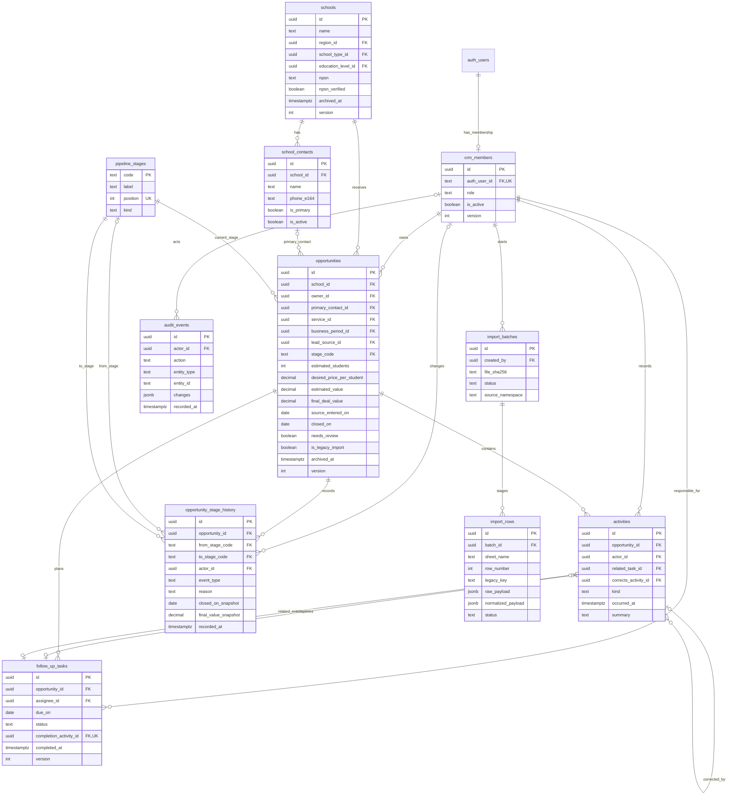
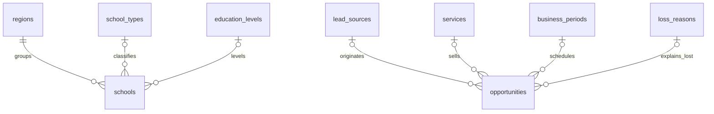
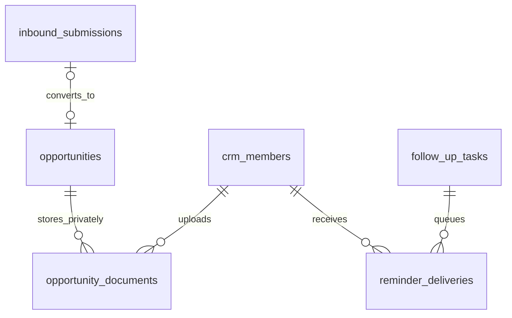

# ERD — Satukelas Marketing CRM

**Versi:** 0.8: Relasi model pengguna & isolasi data server-side selesai dan terverifikasi QA
**Status:** model pengguna terautentikasi (ADMIN dan MARKETER) dengan pemisahan kepemilikan record (`ownerId`) pada entitas Peluang (`Opportunity`) dan Aktivitas (`Activity`) terverifikasi QA v0.8; 46 unit test dan 34 Playwright browser test lolos.
**Acuan:** [PRD](PRD.md) · [UI/UX Requirements](UI_UX_REQUIREMENTS.md)

Model ini untuk CRM internal single-company beserta batas landing publik rekrutmen mitra/anggota tim marketing Satukelas Projects, bukan pengganti ERD website company profile existing. Tabel auth dikelola Better Auth / registry internal server; data domain dikelola aplikasi melalui Drizzle ORM.

### Status implementasi v0.8 — Relasi Data Pengguna & Isolasi Kepemilikan (QA terverifikasi)

1. **Entitas Pengguna (`marketing_users`):**
   - `id`: string unik (`usr_admin_01`, `usr_mkt_01`, `usr_mkt_02`, dst).
   - `email`: string unik case-insensitive.
   - `name`: string nama tampilan PIC.
   - `role`: enum (`ADMIN`, `MARKETER`, `MANAGER`).
   - `passwordHash`: format salt:hash (scrypt).
   - `isActive`: boolean (status aktif / nonaktif).
   - `avatarUrl`: string opsional (data URI `data:image/(jpeg|png|webp);base64,...` atau URI publik gambar profil).
   - `createdAt`: ISO-8601 timestamp pembuatan akun.
   - `updatedAt`: ISO-8601 timestamp modifikasi terakhir.

2. **Entitas Peluang (`marketing_opportunities`):**
   - `id`: string unik (`demo-...`).
   - `ownerId`: foreign key merujuk `marketing_users.id`.
   - `owner`: label nama PIC untuk tampilan.
   - `school`: string nama sekolah berlabel `(Contoh)`.
   - `service`: enum paket layanan BTS/Yearbook.
   - `period`: tahun ajaran (contoh: `2026/2027`).
   - `region`: wilayah jangkauan pemasaran.
   - `stage`: tahap pipeline (`Identified`, `Contacted`, `Proposal`, `Negotiation`, `Won`, `Lost`).
   - `status`: status (`OPEN`, `WON`, `LOST`).
   - `estimate`: integer rupiah atau null.
   - `created`: timestamp / nomor hari relatif.
   - `due`: tanggal target deadline.
   - `nextAction`: deskripsi rencana tindak lanjut.

3. **Entitas Aktivitas (`marketing_activities`):**
   - `id`: string unik aktivitas.
   - `ownerId`: foreign key merujuk `marketing_users.id`.
   - `owner`: label nama PIC.
   - `school`: nama sekolah terkait.
   - `action`: jenis interaksi (Chat, Visit, Call, Meeting, Proposal).
   - `date`: tanggal aktivitas.
   - `result`: hasil interaksi.
   - `note`: catatan detail.

4. **Aturan Isolasi Data (Scoping Rules):**
   - Saat sesi pengguna adalah `role === "MARKETER"`, klausa filter `WHERE ownerId = session.id` diterapkan secara otomatis oleh server pada setiap operasi pembacaan, perincian, agregasi metrik, dan mutasi data.
   - Pembuatan data baru (`POST /api/crm`) mengabaikan input `ownerId` atau `owner` dari client; nilai `ownerId` dipaksakan ke `session.id` dan `owner` ke `session.name`.
   - Saat sesi pengguna adalah `role === "ADMIN"`, server menampilkan dan mengizinkan pengelolaan data seluruh pemilik.

### Kontrak revisi v0.8 — autentikasi Admin + Marketing (spesifikasi teknis)

- Login `/login` menerima role `ADMIN` dan `MARKETER`; role `MANAGER` belum diberi akses. Marketing hanya boleh membuka `/dashboard`, `/opportunities` (alias `/schools`), `/pipeline`, `/follow-ups`, `/activities`, `/reports`. `/settings`, `/admin` dan namespace preview ditolak untuk Marketing pada server, termasuk URL langsung.
- Identitas berasal dari cookie HttpOnly bertanda tangan HMAC-SHA256 dengan batas 8 jam, bukan input role/PIC dari browser. Sesi harus cocok dengan akun aktif pada registry server; token bertanda tangan bukan token terenkripsi.
- Setiap peluang mempunyai `ownerId` stabil yang merujuk ID akun; nama PIC hanya label. Aktivitas terikat ke peluang yang terlihat dan ke pemilik akun. Marketing tidak dapat memilih PIC orang lain; owner pada create ditetapkan server. Read/detail/create/catat hasil/pindah tahap wajib memeriksa sesi dan ownership di server; ID asing menghasilkan 404, tanpa sesi 401, role/area terlarang 403.
- Scope diterapkan sebelum serialisasi ke browser serta sebelum filter, agregasi dashboard, antrean follow-up, pipeline, aktivitas, dan laporan. Query owner/PIC, body ownerId, ID peluang, dan filter URL tidak boleh memperluas scope.
|- Mode implementasi lokal memakai **data sintetis berlabel** dengan store memori proses server untuk akun terautentikasi; perubahan bertahan saat reload tetapi hilang ketika proses restart. Preview anonim berflag tetap simulasi memori tab terpisah. Tidak ada fallback diam-diam ke data bisnis, localStorage, database, schema/migration PostgreSQL, atau audit operasional.
|- Akun contoh dan secret fallback hanya untuk pengujian eksplisit (`MARKETING_ENABLE_DEMO_AUTH=true`) atau unit test; deployment tanpa konfigurasi tidak boleh membuka akun default. Registry Marketing produksi sementara dikonfigurasi server melalui `MARKETING_USERS_JSON` berisi ID unik, email, nama, passwordHash scrypt dan isActive; account management/Better Auth/database tetap tahapan terpisah.
|- **CRUD Member Marketing & Reset Password (Khusus Admin):**
  - Model mutasi akun marketing dikelola secara in-memory oleh store server (`member-store.ts`) yang tersinkronisasi ke registry auth.
  - Penambahan member marketing mewajibkan nama, format email unik, password awal (di-hash menggunakan `hashPassword(password)` ber-salt scrypt), status keaktifan, dan opsional gambar profil avatar (`avatarUrl`).
  - Gambar profil divalidasi format MIME (JPEG, PNG, WebP) dengan batasan ukuran maksimal 2 MB; disimpan dalam format data URI yang aman atau URL gambar statis.
  - Reset password dilakukan oleh Admin via endpoint `POST /api/admin/members/[id]/reset-password`; password baru (minimal 8 karakter) di-hash ulang menggunakan scrypt salt acak dan seketika menggantikan password lama.
  - Penghapusan member marketing memvalidasi bahwa akun bukan Admin; jika akun memiliki peluang terdaftar (`ownerId`), sistem mencegah orphan data dengan opsi pengalihan PIC atau deaktivasi akun (`isActive = false`).
  - Marketer yang dinonaktifkan (`isActive = false`) otomatis ditolak login dan sesi aktifnya langsung digugurkan oleh verifikasi token server.
|- UI mempertahankan desain flat yang disetujui. Marketing menampilkan enam menu, identitas role, keterangan data akun sendiri, PIC otomatis/terkunci, loading/error/sukses mutasi server, dan logout yang membersihkan state. Tidak menampilkan kredensial atau autofill password pada login.
- QA wajib menggunakan dua akun Marketing berbeda plus Admin: akses rute langsung, query owner palsu, response HTML/RSC/API, detail/mutasi ID asing, create owner palsu, aktivitas/agregat, sesi invalid/expired/inactive, logout/login lintas akun dan regresi preview. Hasil aktual dicatat terpisah di laporan QA.

### Status implementasi lokal v0.6 — historis admin preview (QA terverifikasi)

- **Batas tahap:** frontend admin preview untuk review lokal di `apps/marketing`, bukan admin produksi, autentikasi atau bukti otorisasi. Spesifikasi produksi di bawah tetap berlaku; pengecualian preview sintetis lokal ini tidak mengubah landing menjadi demo CRM publik atau menyelesaikan gate backend/keamanan.
- **Akses lokal:** aktifkan `MARKETING_ENABLE_ADMIN_PREVIEW=true` pada proses aplikasi yang ditinjau. URL review: **http://127.0.0.1:3100/preview/dashboard**. Tanpa flag aktif, seluruh route `/preview` harus mengembalikan **404**. Flag ini hanya sakelar preview, **bukan authorization**; jangan mengaktifkannya pada deployment publik.
- **Route preview:** `/preview` mengarah ke `/preview/dashboard` hanya saat flag aktif; halaman lain: `/preview/opportunities`, `/preview/pipeline`, `/preview/follow-ups`, `/preview/activities`, `/preview/reports`, `/preview/settings`. Ini namespace review terpisah dari route produksi pada spesifikasi. `/dashboard` dan API privat tetap belum diimplementasikan/**404**; 404 tersebut bukan kelulusan uji RBAC. Landing `/` dan `/login` informasional tidak berubah, tanpa login/sesi aktif.
- **Data dan waktu:** semua nama, PIC, peluang, nilai, tugas dan aktivitas merupakan **data sintetis berlabel**. Tanggal acuan demo tetap **16 Oktober 2026 WIB (Asia/Jakarta)**, bukan waktu live atau tanggal perangkat; status overdue/hari ini/terjadwal serta validasi waktu demo mengacu tanggal tersebut. Jangan menafsirkan angka preview sebagai kondisi bisnis atau pendapatan riil.
- **State:** perubahan hanya di memori React pada tab yang sedang dibuka; hilang saat reload atau **Reset demo**. Filter/pencarian tersimpan di URL, bukan persistence record bisnis. Tidak memakai localStorage, database, API CRM atau auth; tidak mengimpor workbook, PII, pengguna maupun audit nyata. Tidak ada schema atau migration baru. PostgreSQL + Drizzle ORM/Kit + `pg` + Better Auth tetap rencana backend produksi, belum diaktifkan oleh preview.
- **Cakupan frontend yang harus diverifikasi:** filter PIC/wilayah/layanan/periode dan pencarian URL; tambah prospek sintetis; detail; catat hasil dan next action dalam satu pembaruan lokal atomik; perubahan tahap OPEN dengan alasan untuk skip/mundur; guard Won/Lost; pipeline; aktivitas; laporan demo yang metriknya dihitung dari dataset/filter yang sama; pengaturan yang menjelaskan batas preview serta reset memori. Atomik lokal bukan transaksi database, dan histori demo bukan audit produksi.
- **Desain acuan:** `C:/Users/MSI-PC/exports/satukelas-crm-preview/render_preview.py` dan `DESIGN-NOTES.md`; putih/hitam, Geist, pink `#FD5392` untuk CTA/nav aktif, coral `#F86F64` untuk overdue, apricot `#F6BF75` untuk perhatian. Border 1/2px, radius 4px, flat **tanpa hard shadow pada admin**; sidebar desktop 232px, topbar 72px, gutter desktop 32px. Dashboard action-first: tiga KPI dalam satu kelompok menyatu, antrean follow-up sebagai pusat, pipeline dan aktivitas sebagai pendukung.
- **QA v0.6: TERVERIFIKASI LULUS.** Seluruh 9 pemeriksaan teknis (lint, typecheck, 18 unit tests, build Next.js turbopack, 23 browser E2E Playwright, 0 console error/request failure, 0 axe accessibility violations di 6 viewport 320–1600px, 0 vulnerabilities) dan 19 skenario fungsional ADM-01–ADM-19 tercatat lulus di [QA admin frontend](QA_ADMIN_FRONTEND.md). Belum mencakup UAT pemilik, persistence database, RBAC produksi, benchmark VPS atau deployment produksi.

### Status implementasi lokal v0.5 — historis frontend publik

- Frontend publik tersedia sebagai aplikasi terisolasi di `apps/marketing`, tidak mengganti homepage/CMS existing. URL review: **http://localhost:3100/** (alternatif `http://127.0.0.1:3100/`); URL lokal hanya dapat dipakai pada komputer yang menjalankan server.
- Implementasi Next.js App Router + TypeScript + Tailwind memakai komponen `Button` dengan pola shadcn/ui/Radix Slot, SVG resmi Open Peeps dan Geist lokal. `/login` baru penjelasan akses tim, bukan autentikasi aktif. Route CRM/API privat belum diimplementasikan dan mengembalikan 404; ini bukan bukti RBAC atau keamanan backend yang sudah dibangun.
- Kontrak CTA berlaku: **Gas Mulai Bareng Kami** / **Gas Bikin Cerita Bareng** → `wa.me` dengan pesan ter-encode; navigasi `#gabung` / `#alur` terpisah. Klik tidak mengirim pesan otomatis, tidak membuat akun/lead/session/record CRM. Nomor `6281234567890` diwarisi dari mockup dan **kepemilikannya belum terverifikasi**; konfirmasi nomor tujuan sebelum publikasi atau mengirim pesan. Preview menampilkan peringatan ini, tanpa janji bebas biaya atau waktu respons.
- QA lokal 24 Oktober 2026: build, lint aplikasi marketing, typecheck, **8 unit test** dan **12 tes browser Edge/Playwright** lolos; audit dependency aplikasi marketing melaporkan **0 vulnerabilities** saat dijalankan. Lima viewport diuji: 320, 390, 768, 1024, 1440 px. Pemeriksaan axe otomatis pada landing, halaman akses tim dan halaman 404 lolos di 390/1440 px; bukan sertifikasi aksesibilitas penuh atau UAT pengguna.
- Favicon 404 diperbaiki melalui `src/app/favicon.ico`. Starter standalone menyalin `public` dan `.next/static` lalu menjalankan `.next/standalone/server.js`, dengan bind lokal eksplisit `127.0.0.1` agar tidak memakai `HOSTNAME` bawaan Windows/Git Bash. Landing dan favicon terverifikasi HTTP 200; tes landing tidak mendapati console error, request gagal atau aset HTTP >=400.
- Detail hasil/batas pengujian: [QA frontend publik](QA_PUBLIC_FRONTEND.md). Backend PostgreSQL/Drizzle/Better Auth, migration, otorisasi nyata, backup/restore, kapasitas VPS dan deployment **belum dikerjakan/diuji**. Noindex tetap aktif sampai siap publikasi; keputusan domain/deployment dan UAT pemilik tetap terpisah.

## 1. Prinsip dan konvensi

**Kontrak persistence v0.4:** Drizzle ORM dengan driver `pg` dan connection pool terbatas; Drizzle Kit untuk menghasilkan migration SQL version-controlled. Schema domain TypeScript hanya di server. Gunakan adapter Drizzle untuk Better Auth; schema auth mengikuti kebutuhan adapter/versi paket yang dipilih, tanpa membuat mekanisme password sendiri.

Migration SQL harus ditinjau dan diuji dari database kosong serta upgrade versi sebelumnya sebelum deployment. Constraint, indeks parsial, composite FK, generated column dan transaksi tetap mengikuti kontrak ERD; bila tidak terwakili tooling, gunakan migration SQL khusus yang teruji. Jangan memakai push schema langsung ke production atau mengganti constraint DB dengan validasi client. Tinjau risiko kehilangan data, backup/restore dan rencana rollback untuk perubahan destruktif.


1. **Sekolah ≠ kontak ≠ peluang ≠ aktivitas ≠ tugas.** Peluang mempunyai satu owner, satu layanan opsional saat intake, dan satu periode bisnis opsional saat intake.
2. Domain menggunakan UUID PK, dibuat server. Auth user memakai ID yang dihasilkan adapter Better Auth (teks); jangan memaksanya ke UUID bila adapter tidak demikian.
3. Nama tabel/kolom database `snake_case`; schema TypeScript memakai deklarasi `pgTable` dan nama kolom database eksplisit. Tidak menggunakan sintaks pemetaan ORM lain.
4. `created_at`, `updated_at`, `recorded_at`, `occurred_at`, `completed_at` menggunakan `timestamptz`, disimpan UTC. `source_entered_on`, `closed_on`, `due_on` adalah DATE bisnis WIB. Tidak menyimpan tanggal bisnis sebagai string bebas.
5. Semua FK memakai RESTRICT/NO ACTION untuk hard delete bisnis. Tidak ada cascade penghapusan sekolah→peluang→histori. Akun dinonaktifkan, bukan dihapus. Cascade internal auth mengikuti adapter dan direview agar tidak menghapus domain.
6. Timestamp dibuat server. `version integer NOT NULL DEFAULT 1 CHECK(version>0)` pada record mutable untuk optimistic locking. Immutable records tidak punya tombol edit; koreksi append-only.
7. Notasi kamus: **NN** = NOT NULL; **N** = nullable; **UQ** = unique; **FK** = foreign key. Field yang tidak dinyatakan nullable adalah wajib.
8. Field umum **M** pada tabel master/mutable: `id uuid PK`, `created_at timestamptz NN`, `updated_at timestamptz NN`, `version int NN`. Field actor disebut eksplisit agar tidak mengasumsikan semua record mempunyai pembuat manusia.
9. Nilai uang menggunakan DECIMAL, bukan float; JSON API membawa decimal sebagai string. Nilai unknown adalah null, nol eksplisit tetap nol.
10. Constraint lintas tabel/status yang tidak dapat dinyatakan CHECK lokal ditegakkan oleh transaksi service dan integration test; jangan menulis CHECK berisi subquery.

### 1.1 Batas data landing rekrutmen publik: MKT-FR-019 / MKT-S13

- Landing `/` app-relative mengajak **calon mitra/anggota tim marketing Satukelas Projects** mengenal peran membangun relasi sekolah, mengenalkan karya yearbook/dokumentasi, kolaborasi dan kecocokan. Bukan penjelasan fitur/pipeline CRM atau preview dashboard. Namespace/domain final tetap D-01; tidak mengganti homepage atau CMS existing.
- **Tidak ada tabel baru, migration domain atau endpoint rekrutmen** untuk landing P0. Hero, peran, karya, kecocokan, penjelasan cara bergabung, FAQ, CTA dan metadata adalah konten statis version-controlled. Karakter memakai aset SVG resmi Open Peeps repo sesuai [Character Guidelines](../CHARACTER_GUIDELINES.md), bukan generatif raster atau screenshot dashboard. Putih/hitam/pink `#FD5392`, Geist dan Neo-Brutalisme adalah identitas UI, bukan data domain.
- CTA primer bernada persuasif Gen Z (**Gas Mulai Bareng Kami** / **Gas Bikin Cerita Bareng**) diarahkan langsung ke WhatsApp tujuan kemitraan (nomor preview belum terverifikasi) via tautan `wa.me` berformat pesan otomatis, didampingi navigasi informasional `#gabung` dan `#alur`; tidak ada form, signup atau pembuatan record di database CRM. Pendaftaran diproses langsung via komunikasi WhatsApp interaktif tanpa tabel pelamar di CRM.
- Pengunjung anonim bukan role/member CRM: jangan membuat `crm_members`/session/lead/inbound_submissions untuk page view, klik Lihat langkah bergabung atau klik login. Membaca landing tidak memanggil repository/query database CRM atau lookup sesi, sehingga konten publik tidak bergantung readiness DB. **Masuk akun tim** → `/login` adalah akses sekunder bagi pemilik akun undangan, bukan cara melamar; autentikasi tetap membutuhkan layanan auth yang sehat.
- Public payload hanya copy dan aset publik resmi yang ditinjau. HTML, RSC/JSON, metadata, Open Graph dan SVG/asset publik tidak mengandung kontak sekolah, data peluang/aktivitas, nama PIC internal, angka bisnis asli, raw import atau informasi auth/sesi. Jangan menyanitasi hasil query bisnis lalu mempublikasikannya sebagai demo. Tidak ada preview dashboard publik, termasuk preview sintetis; fixture CRM tetap terpisah untuk uji internal.
- Tidak ada form aplikasi/kontak/lead/demo, signup publik, lead intake, analytics/tracking pihak ketiga atau editor CMS publik pada P0. `inbound_submissions` tetap **P1** MKT-FR-017 dengan autentikasi server-to-server dan review; keberadaan landing tidak mengaktifkannya dan tidak menjadikannya tabel pelamar. Kunjungan landing tidak menulis audit domain CRM; log akses operasional tetap teredaksi dan tidak merekam token.
- Cache publik dibatasi konten/aset statis. Data privat tetap no-store dan diperiksa pada server (loader/Server Action/Route Handler/export/file), termasuk permintaan anonim dengan ID tebakan. Tidak mengandalkan middleware, route group, robots/noindex atau penyembunyian navigasi sebagai satu-satunya pengaman.
- QA-019 memeriksa audiens/narasi rekrutmen, CTA primer `#gabung` dan login sekunder `/login`, aset resmi, ketidakpastian serta larangan klaim/form/intake/endpoint/tabel. Tidak ada data privat di payload/cache/aset; private URL/API/export/file tetap ditolak; DB down tetap memungkinkan landing statis dibaca tanpa query DB/sesi dan tanpa menganggap login/CRM sehat.

## 2. Diagram relasi inti — P0

Relasi enum/referensi digambar terpisah di §3 agar domain utama terbaca. `auth_users` adalah nama logis, bukan asumsi nama tabel adapter.



`import_rows` menyimpan mapping `school_id`/`opportunity_id` nullable setelah commit (lihat kamus). `audit_events.entity_id` bersifat polymorphic, **bukan FK palsu**; validitas target dijamin service/audit transaction. Record audit tidak hilang saat objek diarsip.

## 3. Referensi, seed, dan kardinalitas

Tabel berikut berbagi pola **R**: M + `code varchar(64) NN UQ`, `label varchar(120) NN`, `position int NN DEFAULT 0`, `is_active boolean NN DEFAULT true`. Code stabil tidak diubah setelah dipakai; label boleh diperbaiki dengan audit. Inaktif tidak menghapus referensi historis.

| Tabel | FK pemakai | Seed / catatan |
|---|---|---|
| `regions` | schools.region_id NN | Surabaya, Sidoarjo, Gresik, Luar Sby Raya |
| `school_types` | schools.school_type_id N | Pesantren; Swasta Islam (trim); Swasta Kristen / Katolik; SPK / International; Negeri |
| `education_levels` | schools.education_level_id N | TK / PAUD, SD, SMP, SMA, SMK, Lainnya |
| `lead_sources` | opportunities.lead_source_id N | Direct Visit, Website / Inbound, Instagram, Tim Marketing, Referensi Rekanan, Tiktok, Event Kemitraan, Gmaps, Networking, Repeat Order |
| `services` | opportunities.service_id N | Yearbook Lengkap, Photoshoot, Design + Cetak; satu layanan per peluang MVP |
| `business_periods` | opportunities.business_period_id N | Tidak mengada-adakan tahun ajaran sumber; admin membuat label terkontrol; `starts_on/ends_on DATE N`, jika keduanya ada akhir≥awal |
| `loss_reasons` | opportunities.loss_reason_id N | Seed **usulan**: Budget, Kompetitor, Tidak Ada Respons, Jadwal, Lainnya; daftar perlu validasi bisnis |



Delapan stage **bukan** referensi editable umum. `pipeline_stages(code PK text, label text NN, position int NN UQ, kind text NN)` disiapkan migration dengan code/kind:

| position | code | label | kind |
|---|---|---|---|
| 1 | COLD_LEAD | Cold Lead | OPEN |
| 2 | CONTACTED | Contacted | OPEN |
| 3 | MEETING_SCHEDULED | Meeting Scheduled | OPEN |
| 4 | PRESENTATION_DONE | Presentation Done | OPEN |
| 5 | PROPOSAL_SENT | Proposal Sent | OPEN |
| 6 | NEGOTIATION | Negotiation | OPEN |
| 7 | WON | Deal Closed / Won | WON |
| 8 | LOST | Deal Lost / Rejected | LOST |

Code, urutan, dan kind diproteksi dari mutasi aplikasi; penambahan stage memerlukan migration + pembaruan PRD/UI/tests. Enum status task/role/kind activity dapat berupa PostgreSQL enum atau CHECK text konsisten; pemilihan migration tidak mengubah kontrak nilai.

## 4. Kamus data

### 4.1 Auth dan membership

**Better Auth (P0)** mengelola model logis `user`, `session`, `account`, `verification` sesuai generated adapter schema pada versi yang dikunci di lockfile. User name/email/verification, credential hash, session token/expiry, dan verification token berada di boundary ini. Rancangan ini tidak mengarang kolom hashing atau memakai Supabase Auth.

| Tabel / field | Tipe dan constraint | Makna |
|---|---|---|
| crm_members | M | Profil domain dan hak bisnis, satu per auth user |
| auth_user_id | text NN UQ FK auth user | Adapter name dipetakan saat implementasi, delete RESTRICT dari domain |
| display_name | varchar(120) NN | Nama tampilan PIC; bukan unique identity |
| role | enum NN | ADMIN, MANAGER, MARKETER |
| is_active | boolean NN default true | Dinonaktifkan langsung memutus izin request berikut |
| created_by | uuid N FK crm_members | Null hanya bootstrap terkontrol; bootstrap tidak public |
| deactivated_at | timestamptz N | Wajib bila is_active=false; null bila aktif |

Email akun hanya di auth user, tidak diduplikasi sebagai credential pada crm_members. Nama Yunus/Dzaky/Armando/Yasser di sumber bukan email atau user ID. Mapping dituntaskan admin; akun tidak dibuat dengan password default bersama. Reset memakai flow yang didukung Better Auth, token hashed satu kali TTL 1 jam dan revoke session. Jika versi terpilih tidak mendukung seluruhnya secara native, desain adapter/extension harus direview sebelum G1; jangan menyimpan token mentah di domain.

### 4.2 schools

M + field berikut:

| Field | Tipe | Aturan |
|---|---|---|
| name | varchar(200) NN | Trim, 2–200 karakter; bukan unique sendiri |
| normalized_name | text NN | Normalisasi deterministik untuk pencarian/duplicate warning, bukan merge key |
| region_id | uuid NN FK regions | Wajib input baru; unknown sumber harus exception |
| school_type_id, education_level_id | uuid N FK | Boleh unknown; tidak memakai string “-” |
| npsn | varchar(8) N | Delapan digit jika diisi |
| npsn_verified | boolean NN default false | True hanya setelah pemeriksaan admin/manager; true mensyaratkan npsn |
| address | text N | Maksimum aplikasi 2.000 karakter |
| maps_url, website_url | text N | Hanya https/http terverifikasi sintaks; dibuka client, tidak server-fetch |
| notes | text N | Maksimum 5.000 karakter; plain text, bukan HTML aktif |
| created_by | uuid NN FK crm_members | Admin importer untuk legacy; tidak berarti pemilik peluang |
| archived_at, archived_by, archive_reason | timestamp/uuid/text N | Paket all-null atau terisi bersama; reason 3–500 karakter |

Hard uniqueness hanya NPSN verified aktif historis: partial unique `npsn WHERE npsn_verified=true AND npsn IS NOT NULL`, **tidak** mengecualikan sekolah arsip. NPSN unknown tidak memblokir intake; collision ditangani manager. Duplicate index nama/wilayah/jenjang nonunique.

### 4.3 school_contacts

M + field berikut:

| Field | Tipe | Aturan |
|---|---|---|
| school_id | uuid NN FK schools | Tidak boleh dipindahkan ke sekolah lain sesudah dipakai |
| name | varchar(160) NN | Nama nyata yang diketahui; record tanpa nama ditahan staging, bukan “Kepsek” fiktif |
| position | varchar(120) N | Jabatan/peran, misalnya kepala sekolah |
| phone_e164 | varchar(20) N | Format +62… bila nomor Indonesia valid; bukan field untuk tebakan |
| email | varchar(254) N | Format valid bila diisi; tidak harus akun login |
| notes | text N | Maksimum 2.000 karakter, akses ikut sekolah |
| is_primary | boolean NN default false | Paling banyak satu kontak aktif utama per sekolah |
| is_active | boolean NN default true | Inaktif tetap ada pada histori/peluang lama |
| created_by | uuid NN FK crm_members | Aktor pencatatan |

Minimal satu dari position/phone/email terisi selain name. `is_primary ⇒ is_active`. Unique partial `(school_id) WHERE is_primary AND is_active`. Deaktivasi primary memerlukan memilih pengganti atau mengonfirmasi “belum ada kontak utama”; tidak otomatis memilih orang lain. Nomor sama antar sekolah dapat sah, jadi warning, bukan unique global.

### 4.4 opportunities

M + field berikut:

| Field | Tipe | Aturan |
|---|---|---|
| school_id | uuid NN FK schools | Sekolah aktif saat create/restore |
| owner_id | uuid NN FK crm_members | Wajib akun aktif untuk peluang nonarsip; arsip boleh mempertahankan owner nonaktif sebagai histori. Restore wajib owner aktif atau pengganti aktif atomik; MARKETER atau role lain yang ditunjuk sebagai PIC |
| primary_contact_id | uuid N FK school_contacts | Kontak milik sekolah yang sama; pilih aktif untuk assignment baru |
| service_id, business_period_id, lead_source_id | uuid N FK | Unknown saat intake; layanan/periode wajib Won baru/verified |
| lead_referrer_name | varchar(160) N | Mapping PIC Leads dari sumber; bukan owner atau kontak sekolah |
| lead_referrer_contact | varchar(254) N | Kontak sumber, PII berscope; tidak otomatis WA sekolah |
| source_entered_on | date N | Tanggal input bisnis/sumber; input manual baru default hari ini WIB; legacy kosong tetap null |
| stage_code | text NN FK pipeline_stages | Default COLD_LEAD pada create biasa |
| estimated_students | int N | 0–1.000.000 (batas teknis usulan untuk overflow/validasi) |
| desired_price_per_student | numeric(12,2) N | ≥0; dua desimal, interpretasi per siswa perlu D-03 |
| estimated_value | numeric(18,2) N GENERATED STORED | Siswa × harga; null bila operand unknown, read-only |
| final_deal_value | numeric(18,2) N | >0 untuk Won verified, terpisah dari estimasi |
| closed_on | date N | Tanggal closing bisnis WIB, bukan created_at/import timestamp |
| loss_reason_id | uuid N FK loss_reasons | Wajib untuk Lost verified |
| closing_note | text N | Bukti/referensi kesepakatan atau alasan lost, 3–2.000 karakter untuk terminal verified |
| summary | text N | Catatan peluang maksimum 5.000 karakter, bukan pengganti timeline |
| legacy_last_contact_on | date N | Hanya migrasi, tanggal sumber tanpa membuat aktivitas palsu |
| is_legacy_import | boolean NN default false | Hanya service import dapat mengatur; immutable |
| needs_review | boolean NN default false | Flag migrasi, bukan indikator umum semua field kosong |
| review_issues | jsonb NN default [] | Kode exception terbuka dari import; tanpa secret atau kontak raw |
| verified_at, verified_by | timestamptz/uuid N | Terisi bersama bila admin/manager menyelesaikan review legacy |
| created_by | uuid NN FK crm_members | Aktor create/import |
| archived_at, archived_by, archive_reason | timestamp/uuid/text N | Paket all-null atau terisi bersama |

Normalisasi terhadap `primary_contact_id`: buat unique `(id, school_id)` di school_contacts dan composite FK `(primary_contact_id, school_id)` agar kontak lintas sekolah ditolak DB. FK primary_contact nullable memakai MATCH SIMPLE. Aktif/tidak aktif kontak tetap aturan service saat assignment.

**Perhitungan rancangan SQL (bukan migration terpasang):**

```sql
estimated_value numeric(18,2) GENERATED ALWAYS AS (
  CASE WHEN estimated_students IS NULL OR desired_price_per_student IS NULL
       THEN NULL
       ELSE estimated_students::numeric * desired_price_per_student END
) STORED
```

Drizzle ORM tidak mengirim field generated saat insert/update; mapping read-only/introspection diuji pada versi yang dipilih. Jika tooling tidak mendukung generated column secara langsung, gunakan migration SQL dan projection query yang teruji, bukan menyimpan kalkulasi client sebagai sumber kebenaran. Jangan pernah menggantinya dengan `GENERATED AS (0)`.

**Invariant lokal:**
- OPEN (`stage_code NOT IN ('WON','LOST')`): closed_on, final_deal_value, loss_reason_id, closing_note null.
- WON verified: service/period/closed_on/closing_note terisi, final_deal_value>0, loss_reason_id null.
- LOST verified: closed_on/loss_reason_id/closing_note terisi, final_deal_value null.
- Terminal incomplete hanya bila `is_legacy_import AND needs_review`; uang nonnull tetap tidak negatif. Hanya importer boleh memasukkan pengecualian, audit wajib.
- `needs_review=false` pada terminal memaksa invariant verified. Review di UI tidak boleh clear flag tanpa data wajib.
- `closed_on ≤ tanggal hari ini WIB` divalidasi service, tidak CHECK CURRENT_DATE yang bergantung waktu server.
- Reopen membersihkan field closing aktif; snapshot ada di stage history. Estimasi dan sumber tidak dihapus.

Duplicate opportunities `(school_id, business_period_id, service_id)` diberi warning, **bukan unique**. Missing period/service mengurangi kemampuan mendeteksi duplikat dan diberi catatan kualitas data.

### 4.5 activities

Immutable, tidak memakai M. PK uuid, `created_at timestamptz NN` (waktu dicatat). Field:

| Field | Tipe | Aturan |
|---|---|---|
| opportunity_id | uuid NN FK opportunities | Selalu punya peluang; sekolah dapat diturunkan dari peluang |
| actor_id | uuid NN FK crm_members | Akun pencatat, tetap walau owner berganti |
| kind | enum NN | WHATSAPP, PHONE, VISIT, MEETING, PRESENTATION, PROPOSAL, NOTE |
| occurred_at | timestamptz NN | Waktu kejadian; UI WIB; bukan masa depan; jangan backfill tanggal kosong |
| summary | text NN | 3–2.000 karakter, plain text |
| related_task_id | uuid N FK follow_up_tasks | Opsional; task dan activity harus dalam peluang sama |
| corrects_activity_id | uuid N FK activities | Correction full replacement terhadap event lama dalam peluang sama; tidak boleh diri sendiri/cycle |
| correction_reason | varchar(500) N | Wajib jika corrects_activity_id diisi |
| idempotency_key | uuid NN UQ | Dibuat client per submission lalu dipakai ulang untuk retry; payload berbeda dengan key sama ditolak |

Correction hanya satu direct successor per aktivitas (partial unique corrects_activity_id nonnull). Correction berikutnya merujuk entry correction terkini; leaf event menjadi fakta efektif. Query last contact mempertimbangkan leaf kind komunikasi saja dan membandingkannya dengan `legacy_last_contact_on` menurut aturan tanggal WIB di §7. NOTE koreksi dapat menyatakan event sebelumnya tidak benar terjadi; entry lama tetap terlihat bertanda Dikoreksi. Related task pada correction mengikuti chain event asli dan tidak mengubah completion task yang sudah final.

### 4.6 follow_up_tasks

M + field berikut:

| Field | Tipe | Aturan |
|---|---|---|
| opportunity_id | uuid NN FK opportunities | Harus OPEN dan nonarsip saat create/reschedule/complete |
| assignee_id | uuid NN FK crm_members | Untuk status PENDING harus owner peluang saat ini; pada COMPLETED/CANCELLED dipertahankan sebagai histori, tidak diubah oleh reassignment; tidak arbitrary task collaborator MVP |
| title | varchar(160) NN | 3–160 karakter, tindakan spesifik |
| planned_kind | enum NN | WHATSAPP, PHONE, VISIT, MEETING, PRESENTATION, PROPOSAL, NOTE |
| due_on | date NN | Tanggal WIB; input masa lalu diperbolehkan dengan warning overdue |
| status | enum NN default PENDING | PENDING, COMPLETED, CANCELLED |
| created_by | uuid NN FK crm_members | Aktor pembuat |
| completion_activity_id | uuid N UQ FK activities | Activity dari penyelesaian; exactly one ketika COMPLETED |
| completed_at, completed_by | timestamptz/uuid N | Paket wajib COMPLETED, null pada status lain |
| cancelled_at, cancelled_by, cancel_reason | timestamp/uuid/text N | Paket wajib CANCELLED, null pada status lain; alasan 3–500 |
| last_reschedule_reason | varchar(500) N | Jadwal lama/baru seluruhnya ada di audit; bukan hanya field terakhir |

Cycle FK tasks↔activities diselesaikan tanpa record palsu: create task dahulu; transaksi complete membuat activity (related_task_id=task), kemudian update completion_activity_id task. Keduanya hanya commit bersama. Composite FK dengan opportunity_id menjamin completion activity/related task satu peluang; migration/test memastikan FK cycle legal. `completion_activity_id` unik mencegah satu activity menyelesaikan beberapa task.

Invariant assignee tugas PENDING=owner peluang saat ini, larangan PENDING pada terminal/arsip, dan equality opportunity pada correction diverifikasi dalam transaksi terkunci; bukan mengandalkan UI. Assignee tugas COMPLETED/CANCELLED adalah histori dan tidak mengikuti perubahan owner. Lihat §6.

### 4.7 opportunity_stage_history

Immutable PK uuid; field:

- `opportunity_id uuid NN FK`, `from_stage_code text N FK`, `to_stage_code text NN FK`.
- `actor_id uuid N FK`: null hanya job sistem terkontrol; import memakai admin pengunggah.
- `event_type enum NN`: CREATED, TRANSITION, REOPENED, LEGACY_IMPORTED, LEGACY_VERIFIED.
- `reason text N` (3–500 bila transisi melompat/mundur/reopen), `recorded_at timestamptz NN`.
- `closed_on_snapshot date N`, `final_value_snapshot numeric(18,2) N`, `loss_reason_id_snapshot uuid N FK`, `closing_note_snapshot text N`.
- `idempotency_key uuid NN UQ` untuk request transisi/create/import/verifikasi.

CREATED/LEGACY_IMPORTED from=null. LEGACY_VERIFIED boleh from=to; bukan dianggap transisi kedua atau closing kedua. TRANSITION wajib from≠to. Tidak membuat delapan histori hanya karena diimpor pada tahap keenam. Pemilihan histori terbaru bukan cara menghitung current stage; current field dan histori diubah atomik.

### 4.8 audit_events

Immutable PK uuid; `recorded_at timestamptz NN`, `actor_id uuid N FK`, `request_id uuid NN`, `action varchar(80) NN`, `entity_type varchar(80) NN`, `entity_id text NN`, `changes jsonb NN`, `reason varchar(500) N`.

Action misalnya OPPORTUNITY_UPDATED, OWNER_REASSIGNED, TASK_RESCHEDULED, TASK_CANCELLED, CONTACT_UPDATED, RECORD_ARCHIVED, EXPORT_CREATED. Audit menyimpan metadata minimum dan before/after **hanya field yang di-allowlist** seperti ID owner, stage, angka nilai, due_on, status. Tidak menyimpan password/hash/token, isi file, email/telepon mentah, atau full free-text note. Perubahan PII dicatat nama field yang berubah dan aktor, bukan isi lama/baru. Histori domain aktivitas/bukti closing tetap privat dan tidak disalin ke log umum.

Tidak menjanjikan audit tamper-proof terhadap administrator DB/root. DB role aplikasi tidak memperoleh UPDATE/DELETE pada tabel history/audit; kebijakan retensi khusus dieksekusi operator berwenang setelah D-07.

### 4.9 import_batches dan import_rows

| Tabel / field | Tipe / aturan |
|---|---|
| import_batches | M; `created_by uuid NN FK`, `source_namespace text NN`, `file_sha256 char(64) NN`, `original_name text NN`, `storage_key text NN`, `status enum NN`, `mapping jsonb NN`, `counts jsonb NN`, `committed_at timestamptz N`, `error_code text N` |
| batch.status | UPLOADED → VALIDATING → REVIEW → READY → COMMITTING → COMMITTED; FAILED untuk kegagalan validasi/commit, tidak partial commit. READY hanya saat tidak ada blocking issue. |
| import_rows | PK uuid; batch_id FK NN, sheet_name text NN, row_number int NN, legacy_key text N, raw_payload jsonb NN, normalized_payload jsonb N, issues jsonb NN default [], status enum NN, school_id/opportunity_id UUID FK N, reviewed_by UUID FK N, reviewed_at timestamp N |
| row.status | PENDING, ACCEPTED, REJECTED, TEMPLATE_ORPHAN, COMMITTED. ACCEPTED dapat membawa warning nonblocking; rejected tetap tercatat dengan alasan. |

- UQ `(batch_id,sheet_name,row_number)`; UQ `(source_namespace,file_sha256)` di batch mencegah upload identik menjadi commit ganda. Retry melanjutkan batch yang sama.
- Namespace sumber stabil dan disetujui admin; sheet+legacy_key menjadi identity sumber. Pada reimport file berbeda, cari mapping committed sebelumnya. Existing mapping ditinjau sebagai UPDATE_CANDIDATE, tidak insert ulang. Perubahan nomor yang ambigu masuk blocking issue; tidak dipetakan lewat nama semata.
- `normalized_payload` menyimpan action rencana CREATE/UPDATE/SKIP dan version target untuk mencegah overwrite perubahan web sejak preview. Commit menolak seluruh batch jika versi target berubah.
- Untuk satu nomor master+progress, entity sama dimapping pada kedua row. Entity FK hanya diisi bila diterapkan; template/rejected tidak punya entity.
- Raw import berisi PII: akses ADMIN saja, storage privat dan batas retensi D-07. Tidak disertakan dalam ZIP dokumen/specifikasi atau git.
- Batas MVP: file 5 MiB, 2.000 master rows/batch, batas jumlah entry/expanded bytes XLSX, parser tanpa macro/evaluasi formula/external link. Formula yang diterima hanya pola sumber terpetakan; operand data dibaca dan hasil dihitung ulang. Formula tak dikenal menjadi blocking issue sampai ditinjau dan dipetakan atau baris ditolak; tidak pernah dieksekusi.

## 5. Entitas P1 — belum masuk migration MVP



| Entitas | Field / aturan utama |
|---|---|
| opportunity_documents | M; opportunity_id FK NN, uploaded_by FK NN, original_name text NN, storage_key opaque UQ NN, mime_type text NN, bytes bigint NN 1..10MiB, sha256 char64 NN, archived_at N. PDF saja, magic signature+MIME+extension, karantina/scan sebelum ready, di luar public web root; streaming authorized download Content-Disposition attachment. |
| inbound_submissions | M; source text NN, external_request_id text NN, payload jsonb NN privat tervalidasi, status NEW/REVIEWED/CONVERTED/REJECTED, reviewed_by/at N, converted_opportunity_id UQ FK N; UQ(source,external_request_id). Tidak auto-merge atau auto-assign dari payload client publik. |
| reminder_deliveries | M; task_id FK NN, recipient_id FK NN, channel text NN, scheduled_for date NN, status QUEUED/SENDING/SENT/FAILED/CANCELLED, attempt_count int NN, sent_at N, provider_message_id N; dedupe UQ(task_id,recipient_id,channel,scheduled_for). Lock cron host, recheck task/owner/izin sebelum kirim, retry terbatas. |

Endpoint reminder/inbound tidak menjadi pintu bypass policy CRM. Reminder tidak mengirim isi kontak/PII sebelum kanal, retensi, dan otorisasi D-08 ditetapkan.

## 6. Transaction boundary dan state machine

### 6.1 Matriks tahap

| From | To | Role yang berhak dalam scope | Guard / efek |
|---|---|---|---|
| Create normal | COLD_LEAD | A/M/owner MARKETER | Sekolah aktif + owner aktif; stage history CREATED |
| OPEN | OPEN berbeda | A/M/owner MARKETER | Alasan wajib jika mundur atau skip; row version cocok; history TRANSITION |
| OPEN | WON | A/M/owner MARKETER | Final value>0, service/period, closed_on dan note; cancel seluruh pending task; snapshot history |
| OPEN | LOST | A/M/owner MARKETER | Loss reason, closed_on, note; cancel pending task; snapshot history |
| WON/LOST | OPEN | A/M saja | Alasan wajib; clear closing fields; history REOPENED; tidak revive task |
| WON | LOST atau sebaliknya | Tidak langsung | Reopen dahulu, lalu transisi valid |
| Stage sama | Stage sama | No-op normal | Tidak membuat history ganda; LEGACY_VERIFIED adalah event khusus |
| Import | Stage sumber terpetakan | ADMIN | Boleh legacy incomplete berflag; history LEGACY_IMPORTED, tidak membuat histori palsu |

A=ADMIN, M=MANAGER. Role saja tidak cukup; scope dan status aktif tetap diperiksa.

### 6.2 Operasi atomik

Guard arsip berlaku server-side pada seluruh jalur termasuk import: record arsip hanya boleh dibaca/diexport sesuai scope atau direstore oleh A/M. Tolak update domain, transisi/reopen, reassignment biasa, pencatatan/koreksi aktivitas, verifikasi legacy dan mutasi tugas sampai restore; penggantian PIC nonaktif hanya boleh atomik dalam restore.

Semua mutasi terhadap satu peluang mengambil lock row peluang **terlebih dahulu**, lalu child/task dalam urutan ID stabil. Pemeriksaan role/assignment aktif diulang di dalam transaksi, bukan hanya sebelum dialog dibuka. Ini mencegah task terselip sesudah proses closing/reassign memeriksa daftar task.

| Operasi | Satu transaksi harus mencakup |
|---|---|
| Create sekolah + peluang | school, opportunity, initial history, audit; kegagalan salah satu rollback semua |
| Update peluang | `UPDATE ... WHERE id=? AND version=?`, increment version, audit; zero affected rows → conflict/unauthorized, bukan sukses |
| Transisi/close/reopen | Lock/version opportunity, validasi guard, update fields, insert history, cancel task bila terminal, audit; tidak ada sukses parsial |
| Create/reschedule/cancel task | Lock opportunity+task, guard OPEN/nonarsip/owner, versi task, mutation+audit; version peluang ikut increment untuk membuat detail invalidation konsisten |
| Complete task | Lock opportunity+task, status PENDING, insert activity dengan idempotency key, update task completion, audit; retry key+payload sama mengembalikan hasil pertama tanpa insert kedua |
| Reassign | Lock opportunity, cek owner baru aktif, update owner + pending task assignee + versions + audit; aktivitas/history aktor lama tidak ditulis ulang |
| Deactivate user | Lock member dan seluruh peluang tanggung jawab dalam urutan stabil, transfer semua peluang nonarsip/pending tasks, revoke sessions + inactive flag; lindungi admin terakhir |
| Arsip peluang | Lock opportunity, set archive metadata, cancel pending task, audit; stage tidak diganti menjadi LOST |
| Restore peluang | Lock school+opportunity, sekolah aktif, recheck owner aktif; jika nonaktif wajib PIC pengganti aktif oleh A/M dan assignment atomik; clear archive metadata + audit; stage lama tetap, task batal tetap batal, aktor histori tidak diubah |
| Verify legacy | Lengkapi data+clear review issues+flag, validasi terminal jika perlu, insert LEGACY_VERIFIED dan audit; tidak memalsukan kontak/tanggal |
| Commit import | Recheck mapping/target versions, create/update entities + histories + row mappings + batch status; kegagalan rollback seluruh batch kecil |

Lock order operasi lintas sekolah/user ditetapkan konsisten di implementation contract agar tidak deadlock; deadlock retry bounded dengan key request yang sama. Tidak ada network call eksternal di dalam transaksi DB. Untuk P1 file, upload privat pending terlebih dahulu, persist metadata hanya sesudah validasi; garbage collection file yatim terpisah.

## 7. Derived fields dan query contract

| Field UI | Sumber/derivasi, bukan kolom baru tanpa alasan |
|---|---|
| Nama sekolah/wilayah/jenis/jenjang | JOIN schools dan referensi sesuai scope; payload minimal |
| Nama PIC | crm_members.display_name dari owner_id saat ini |
| Kontak utama | opportunities.primary_contact_id bila ada, fallback kontak aktif is_primary; tetap dibedakan eksplisit vs fallback |
| Estimasi nilai | Generated opportunities.estimated_value |
| Next action | task PENDING paling awal `(due_on,created_at,id)` |
| Prioritas kerja | Derivasi PRD §8: Terlambat → Hari ini → Belum terjadwal → Terjadwal; terminal/arsip tidak masuk antrean. Kategori bertanggal: next due ASC, created_at peluang ASC, id ASC; tanpa jadwal: created_at peluang ASC, id ASC. Tidak ada field prioritas manual |
| Status follow-up | CASE stage terminal/ada task/due_on vs hari ini WIB; tidak disimpan sebagai string yang basi |
| Last contact | Bandingkan tanggal WIB dari effective leaf komunikasi MAX occurred_at dengan legacy_last_contact_on; pilih tanggal lebih baru, tie memilih aktivitas. Waktu asli aktivitas tetap tersedia; legacy tanggal saja tanpa jam buatan; keduanya null → belum diketahui. Catatan internal/event import tidak dihitung sebagai aktivitas kontak |
| Won verified | stage=WON AND needs_review=false AND invariant terminal terpenuhi |
| Badge kelengkapan | Hitung field yang tersedia dan review issues; jangan menyamakan unknown dengan invalid |
| Jumlah sekolah | COUNT DISTINCT school_id dari peluang dalam scope |
| Nilai final / win rate / conversion | Rumus PRD §8, query server yang sama dipakai dashboard dan export |

Default API pagination 25, maksimum 100, sorting allowlist. Tie-break `(sort_field,id)` stabil. Whitelist filter/sort; parameter tidak disisipkan sebagai SQL identifier mentah. Scope owner difilter di SQL sebelum paginate/agregasi, tidak sesudah fetching semua data.

Contoh projection detail mengirim `id,version,school summary,stage,owner,values,next task,allowed_actions`. `allowed_actions` membantu UI tetapi server tetap memverifikasi ulang tiap mutasi. Data auth account/session/verification tidak pernah dikirim dalam detail domain.

## 8. Index dan constraint fisik yang direncanakan

| Tabel | Index/constraint | Tujuan |
|---|---|---|
| crm_members | UQ auth_user_id; (is_active,role) | Mapping login dan owner selector |
| schools | (region_id,education_level_id); (normalized_name,region_id); partial UQ verified npsn | Filter/duplikat; btree normalized_name untuk prefix. `pg_trgm` opsional jika benchmark contains search membutuhkannya |
| school_contacts | (school_id,is_active); partial UQ primary; UQ(id,school_id) | Kontak dan composite FK |
| opportunities | (owner_id,stage_code,id) WHERE archived_at IS NULL; (school_id,business_period_id,service_id); (closed_on,id); (source_entered_on,id); (business_period_id,service_id) | Scope, stage, duplicate warning, laporan |
| follow_up_tasks | (opportunity_id,due_on,created_at,id) WHERE status='PENDING'; (assignee_id,due_on,id) WHERE status='PENDING'; UQ completion_activity_id; UQ(id,opportunity_id) | Next action dan queue follow-up |
| activities | (opportunity_id,occurred_at DESC,id); UQ idempotency_key; partial UQ corrects_activity_id; UQ(id,opportunity_id) | Timeline, dedupe, correction dan composite FK |
| opportunity_stage_history | (opportunity_id,recorded_at,id); UQ idempotency_key | Histori dan retry |
| audit_events | (entity_type,entity_id,recorded_at); (actor_id,recorded_at); (request_id) | Audit metadata tanpa full text PII |
| import_batches | UQ(source_namespace,file_sha256); (created_by,created_at) | Dedupe dan status |
| import_rows | UQ(batch_id,sheet_name,row_number); (batch_id,status); (legacy_key,sheet_name) | Rekonsiliasi dan mapping reimport |

Tambahkan index FK sesuai actual query plan, bukan otomatis semua kombinasi. Gunakan EXPLAIN ANALYZE pada fixture 10.000 peluang sebelum tuning. Belum ada hasil query plan atau benchmark saat dokumen ini ditulis.

## 9. Mapping sumber spreadsheet

| Field sumber | Tujuan / transformasi |
|---|---|
| MASTER DATA.No. | import_rows.legacy_key; normalize integer string (`1.0`→`1`) tanpa mengubah raw; bukan PK |
| Nama Sekolah | schools.name + normalized_name; sekolah unit/jenjang ditinjau, tidak auto-merge |
| PIC Leads / Kontak Sumber Leads | opportunity.lead_referrer_name/contact; tidak membuat akun/kontak sekolah |
| PIC Marketing | Mapping admin→crm_members.id; unmapped blocking |
| Daerah / Wilayah | regions.code/id melalui alias disetujui |
| Jenis Sekolah / Jenjang | FK referensi; trim termasuk `Swasta Islam `; unknown/null dipertahankan |
| Estimasi Siswa | opportunity.estimated_students; integer nonnegative, mixed text jadi issue |
| Harga yang Diinginkan | desired_price_per_student sesudah D-03; null tetap null; decimal presisi |
| Kontak Person / Kepsek + No. WhatsApp / Telp | school_contacts bila nama+informasi valid; raw problem di staging; nomor tidak difabrikasi |
| Tanggal Input Sekolah | source_entered_on; kosong tetap null, created_at adalah import timestamp |
| Sumber Leads / Pilihan Layanan | FK reference; nilai tak dikenal blocking atau explicit approved alias |
| PROGRESS.No. | Join ke master melalui legacy key; tidak join berdasarkan nomor baris |
| Status Pipeline | stage_code melalui mapping label persis/alias; empty stage pada master valid membutuhkan keputusan admin, bukan otomatis Won |
| Tgl Kontak Terakhir | legacy_last_contact_on; bukan fabricated activity |
| Jadwal Next Action + Aktivitas Tindak Lanjut | Jika ada tanggal dan deskripsi: candidate task; tanggal tanpa deskripsi perlu review; sumber snapshot semuanya kosong |
| Catatan Perkembangan | summary sebagai catatan legacy bertanda sumber, bukan aktivitas bertanggal tebakan |
| Formula lookup, Estimasi Nilai, Status Follow-up | Dihitung ulang; jangan simpan cache formula sebagai fakta otoritatif |
| Dashboard dan area analitik MASTER REFERENSI | Bukan row transaksi; tidak diimpor sebagai sekolah/peluang |

Snapshot baseline: 22 sekolah/candidate opportunities; 13 template orphan; 21 OPEN; 1 legacy Won unverified; 4 estimasi diketahui total Rp72.210.000 lintas tahap; 18 estimasi unknown. Rekonsiliasi ini bukan klaim kontrak/pendapatan. Hash snapshot ada di PRD §2.

## 10. Security, retensi, dan backup

- Role runtime DB hanya hak yang dibutuhkan; migration user terpisah, password bukan superuser Postgres. App server satu-satunya pemilik akses DB runtime.
- Model RBAC di server + scoped repositories; PostgreSQL RLS dapat ditambah setelah desain session context, tetapi **tidak diklaim terpasang**. Jangan mencampur RLS Supabase dengan auth Better Auth tanpa rancangan.
- PII: school_contacts, referrer contact, free-text, file privat, raw import. Jangan kirim record tak berhak dalam SSR payload, client cache, autocomplete, log, search, export, signed file URL, atau error.
- Private response no-store; cache lintas user dilarang. Reassignment/session deactivate segera berlaku; export/file harus cek ulang hak akses sebelum stream.
- Log menyimpan request/error ID dan metadata teredaksi, bukan dump DB/payload. Raw import tidak dibundel bersama dokumentasi atau commit git.
- Hard delete/anonimisasi dan retensi belum final (D-07). Pengarsipan bukan pemenuhan penghapusan PII. Sebelum production tentukan proses permintaan hapus, termasuk backup dan free-text.
- Backup baseline usulan: pg_dump konsisten + file privat + manifest/hash/version, terenkripsi off-server; retensi 7 harian/4 mingguan; restore pada DB bersih dengan versi kompatibel. RPO≤24 jam/RTO≤4 jam adalah target yang harus diukur.
- Tidak ada janji container menahan akses root/Docker socket Hermes. Permission host, secrets, backup credentials dan file mount dipisahkan, hindari Docker socket pada container app.

## 11. Checklist verifikasi implementasi nanti

- [ ] Migration up dari DB kosong dan upgrade dari versi sebelumnya diuji; seed stage/reference idempotent.
- [ ] Generated decimal null/0/upper-bound teruji; Drizzle ORM tidak menulis generated field.
- [ ] Semua FK dan constraint, termasuk cross-school contact/cross-opportunity task, ditolak pada input invalid.
- [ ] Auth adapter schema/credential reset/session revoke diuji, bukan pseudo-schema buatan.
- [ ] Unit/integration tests state matrix, correction chain, WIB midnight, reopen dan legacy verification.
- [ ] Race: task create vs closing; complete vs reassign; dua stage mutation; batch commit vs web edit; key retry berbeda payload.
- [ ] Seluruh API/report/export/file berscope; audit dan raw import hanya authorized.
- [ ] QA-019: landing rekrutmen statis terbuka tanpa query DB/sesi; Lihat langkah bergabung → #gabung hanya penjelasan, login akun undangan sekunder → /login. SVG Open Peeps repo sesuai pedoman, tanpa preview dashboard/penjelasan fitur CRM/klaim tak bersumber/form/signup publik/lead intake/endpoint rekrutmen/tabel baru. Ketidakpastian saluran aplikasi/kontak, skema kerja, seleksi dan syarat final eksplisit. Payload/aset/cache publik bersih dari PII/sesi; permintaan anonim ke data/API/export/file privat ditolak. Tidak ada member/session/lead otomatis dari page view atau klik CTA.
- [ ] Migrasi snapshot direkonsiliasi, unknown tidak jadi nol/tanggal hari ini; reimport tidak menambah duplikat.
- [ ] Restore DB+file di lingkungan baru dan perbandingan jumlah/hash/izin berhasil.

**Riwayat revisi:**

- **0.6, frontend admin preview lokal:** fixture dan mutasi hanya di memori React, tanpa import data riil, persistence, schema/migration atau API/auth baru. Model logis, constraint dan transaksi produksi tetap rancangan; QA admin pending di `QA_ADMIN_FRONTEND.md`.
- **0.4, keputusan pengguna:** persistence menggunakan Drizzle ORM + Drizzle Kit, driver `pg` dan adapter Drizzle Better Auth; memperbarui pemetaan schema, generated column dan pengujian migration tanpa mengubah entitas/relasi bisnis. Belum ada migration yang dieksekusi.
- **0.3, revisi eksplisit pengguna:** mengganti batas konten MKT-FR-019/MKT-S13/QA-019 menjadi landing rekrutmen calon mitra/anggota tim marketing. Preview dashboard/penjelasan fitur CRM publik dihapus; CTA primer Lihat langkah bergabung menuju anchor penjelasan, login sekunder akun undangan. Aset resmi Open Peeps, batas klaim dan ketidakpastian proses bergabung ditegaskan; tanpa tabel, migration atau endpoint rekrutmen baru.
- **0.2 (historis, arah konten digantikan 0.3):** menambahkan permukaan baca publik dan batas payload tanpa tabel baru.
- Invariant internal, diagram relasi, transaksi, migrasi, keamanan/pemisahan payload, entitas P1, route app-relative serta keputusan domain/deployment/Docker yang tertunda tidak berubah.

Checklist ini adalah pekerjaan pengembangan berikutnya. Penyerahan dokumen tidak berarti tabel sudah dibuat, auth aman teruji, atau VPS sudah dikonfigurasi.
