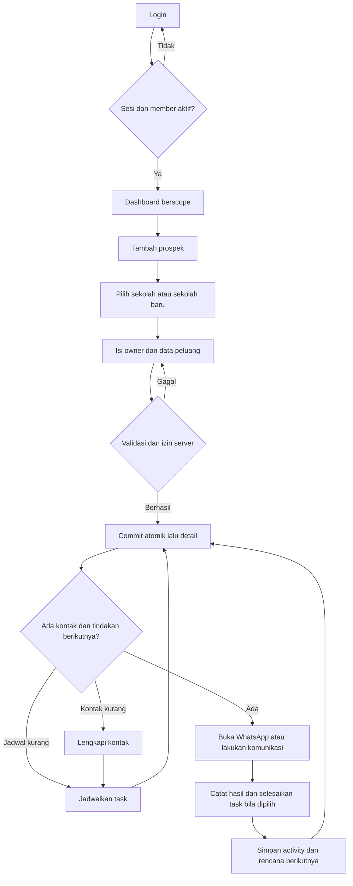
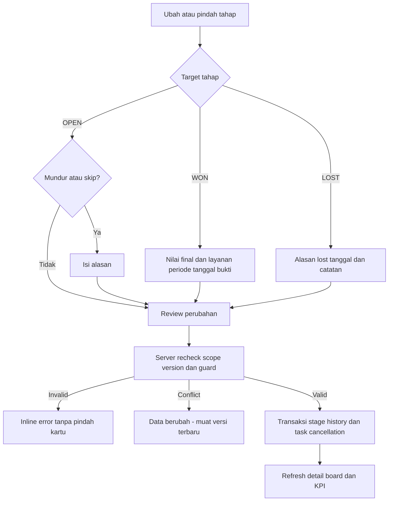
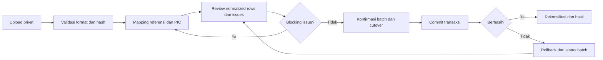
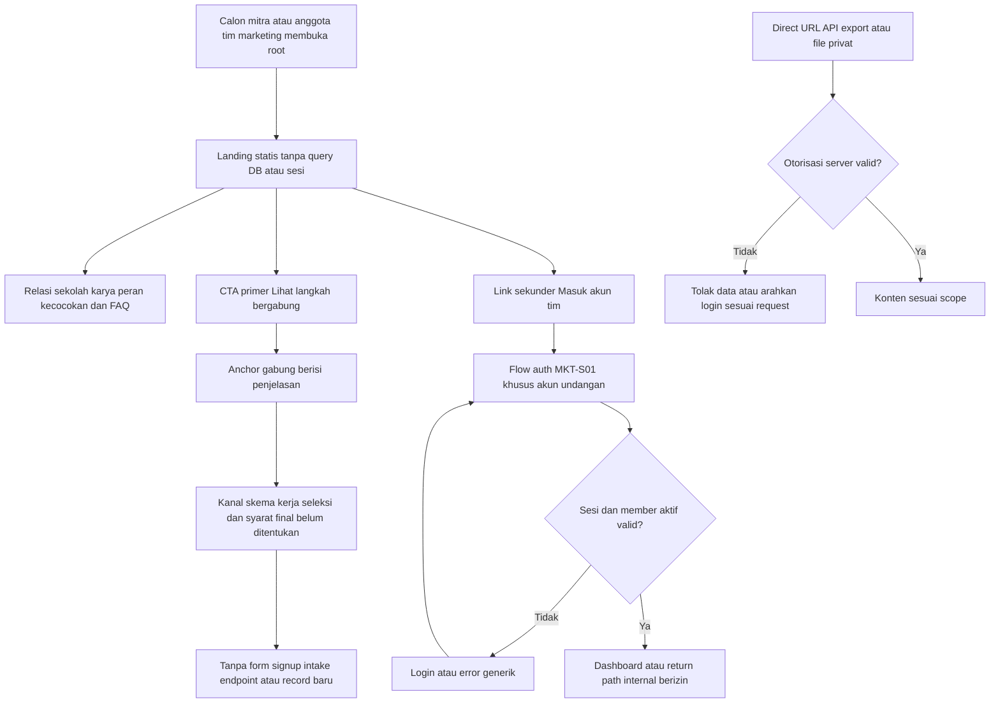

# UI/UX Requirements — Satukelas Marketing CRM

**Versi:** 0.13: Generator Kartu Nama Web Admin, Pengaturan Akun, dan Landing Member Tanpa Grid Statis/Bundling
**Status:** implementasi generator kartu nama otomatis (`MKT-S15`), panel pengaturan akun & ganti password pengguna (`MKT-S16`), serta landing member tanpa katalog produk statis dan bundling. Penegasan: tidak ada formulir pendaftaran magang. Hasil uji tercatat di [QA Member Landing](QA_MEMBER_LANDING.md).
**Pasangan:** [PRD](PRD.md) · [ERD](ERD.md)
**Mode pengalaman:** **Operate** untuk ruang kerja CRM; **Persuade / recruitment** untuk MKT-S13; **Personal Sales & Showcase** untuk landing profil member MKT-S14 (`/tim/[slug]`, `/m/[slug]`); **Digital & Physical Identity** untuk Generator Kartu Nama MKT-S15; **Self-Service Account Management** untuk Pengaturan Akun MKT-S16.

### Kontak member marketing — admin

- Form tambah/edit: Nama Lengkap PIC, Alamat Email Aktif (akun login), Nomor Telepon / WhatsApp (`tel`, maksimal 30 karakter), Alamat Tempat Tinggal (textarea, maksimal 500 karakter).
- Email wajib, format valid dan unik. Label "aktif" adalah arahan pengisian, bukan status email terverifikasi; belum ada verifikasi email.
- Telepon dan alamat opsional agar kompatibel dengan data lama; isian kosong menghapus nilai sebelumnya. Semua nilai di-trim dan divalidasi di server sebelum mutasi.
- Tabel admin menampilkan kolom ringkas: Member / PIC, Email aktif, Status, Prospek Dikelola, Terdaftar, dan Aksi. Kolom nomor telepon dan alamat dipindahkan dari tampilan tabel utama ke Modal Detail Akun Member agar tabel tetap rapi dan tidak memerlukan horizontal scroll berlebihan.
- Tombol CTA "Detail" pada setiap baris member membuka modal dialog detail lengkap berformat Neo-Brutalism (Avatar, Nama PIC, Tag Role & Status Akun, ID Pengguna, Alamat Email Aktif, Nomor Telepon/WhatsApp lengkap dengan tautan telepon dan tombol aksi Chat WhatsApp, Alamat Tempat Tinggal internal yang aman dari publikasi, Prospek Dikelola, Tanggal Terdaftar, serta tombol aksi pintas Edit Akun, Reset Password, Kartu Nama, dan Landing Page).
- Alamat merupakan data internal: jangan sertakan pada props client publik, landing page, kartu nama, maupun respons tanpa otorisasi admin.
- Registry member saat ini in-memory: refresh pada proses yang sama mempertahankan nilai, restart proses menghapus perubahan. Belum menjamin persistensi database.

### Kontrak antarmuka v0.13 — Generator Kartu Nama (MKT-S15) & Pengaturan Akun (MKT-S16)

1. **Komponen Generator Kartu Nama Otomatis (`MKT-S15`):**
   - **Gaya Desain Neo-Brutalisme Satukelas:**
     - Proporsi kartu fisik standar (90mm x 54mm, rasio aspek 1.67:1).
     - Border tegas hitam 2px, sudut solid, palet warna brand: dasar putih `#FFFFFF`, teks hitam `#1A1D20`, aksen merah muda `#FD5392`, biru `#4150B1`, dan kuning `#F6BF75`.
   - **Tampilan Dua Sisi (Double-Sided):**
     - **Sisi Depan:** Logo Satukelas Projects, Nama Lengkap PIC dengan font tebal Geist, Jabatan / Title, badge PIC terverifikasi, detail kontak (WhatsApp dan Email), serta URL landing page referral (`satukelas.com/tim/[slug]`).
     - **Sisi Belakang:** Tagline resmi ("Solusi Buku Tahunan Sekolah & Kenangan Tak Terlupakan"), daftar 4 pilar layanan Satukelas (Buku Tahunan Cetak, Augmented Reality, Video Dokumentasi, Desain Kustom Eksklusif), dan QR Code dinamis kontras tinggi yang dapat discan menuju landing page personal PIC atau kontak WhatsApp.
   - **Kontrol Interaksi Preview:**
     - Tombol toggle mode tampilan: [Sisi Depan], [Sisi Belakang], [Berdampingan (Depan & Belakang)].
     - Opsi pilihan tema: Klasik Kontras (White/Pink), Elegan Gelap (Dark/Pink), dan Neo-Kuning (Yellow/Black).
     - Opsi tujuan QR Code: Link Profil Landing Page atau Direct Chat WhatsApp.
   - **Aksi Ekspor:**
     - **Unduh Kartu (PNG):** Render sisi depan dan/atau belakang ke HTML5 Canvas resolusi tinggi (300 DPI, lebar 1050px) dengan sekali klik tombol `Unduh Kartu (PNG)`.
     - **Cetak Kartu (Print):** Membuka dialog print browser yang mengaktifkan aturan `@media print` terisolasi: menyembunyikan navigasi, sidebar, header, dan elemen admin lain, serta menampilkan kartu nama dengan garis potong (cut marks) siap cetak di kertas A4 atau kertas foto.
     - **Salin Tautan:** Tombol cepat menyalin URL landing page PIC untuk dibagikan ke calon klien sekolah.
   - **Aksesibilitas & Penempatan:**
     - Admin: Tombol `[Kartu Nama]` pada setiap baris member di tabel Tim Marketing (`/members`).
     - Marketer & Admin: Tombol "Kartu Nama Saya" di area profil sidebar untuk akses cepat kartu nama pribadi.

2. **Komponen Pengaturan Akun & Keamanan Pengguna (`MKT-S16`):**
   - **Aksesibilitas Multi-Role:** Dapat diakses oleh Admin maupun Member Marketing yang sedang login melalui tombol "Pengaturan Akun" di sidebar web admin.
   - **Struktur Form Pengaturan:**
     - **Tab 1: Data Diri / Profil Akun:**
       - Input Nama Lengkap (wajib).
       - Input Alamat Email Akun (wajib, divalidasi keunikan oleh server).
       - Input Nomor WhatsApp / Telepon PIC (format angka/telepon internasional atau lokal).
       - Input Jabatan / Title (contoh: "Konsultan Buku Tahunan").
       - Foto Profil / Avatar: Preview gambar avatar saat ini, tombol upload gambar lokal (otomatis dikonversi ke data URL base64 atau input URL avatar), dan opsi reset ke inisial nama.
       - Badge penunjuk Role pengguna (read-only: `ROLE: ADMINISTRATOR` atau `ROLE: MARKETER`).
     - **Tab 2: Keamanan / Ganti Kata Sandi:**
       - Input Kata Sandi Saat Ini (wajib untuk verifikasi otentikasi).
       - Input Kata Sandi Baru (minimal 8 karakter).
       - Input Konfirmasi Kata Sandi Baru.
       - Tombol "Perbarui Kata Sandi".
     - **Area Pengaturan Sistem (Khusus ADMIN di `/settings`):**
       - Tetap menyediakan panel Status Implementasi dan Reset Data Demo untuk keperluan simulasi lokal.
   - **Umpan Balik Pengguna:**
     - Notifikasi toast / alert inline dengan status aksesibel (`role="status"`, `aria-live="polite"`).
     - Validasi form interaktif mencegah submit kosong atau password baru yang tidak cocok.

3. **Penegasan Batasan (Tanpa Form Magang):**
   - Tidak ada antarmuka, tautan menu, form input, atau dialog penerimaan magang.

### Kontrak antarmuka profil member & area layanan v0.13 (MKT-S14)

- **Identitas Visual Contra Neo-Brutalisme:** Border solid 2px hitam (`#000000`), hard drop shadow 4px (`box-shadow: 4px 4px 0px #000000`), radius tegas 0px atau pill badge, palet putih bersih, hitam pekat, primary pink `#FD5392`, support blue `#4150B1`, yellow `#F6BF75`, dan font Geist.
- **Hero Profil Member:** Avatar foto asli (atau karakter SVG editorial Satukelas), badge status "PIC RESMI SATUKELAS", nama lengkap, headline ramah konsultatif, serta tombol CTA cepat WhatsApp.
- **Area Produk:** Pertahankan `#produk`, label katalog dan heading “Karya Kenangan & Solusi Media Sekolah”. Hapus grid `#produk > div > div:nth-child(2)`, kartu, harga dan CTA produk statis. Tidak menampilkan kartu pengganti atau status API palsu.
- **Tanpa Bundling:** Hapus section `#paket`, tautan header/footer dan opsi All-in-One pada form. Sumber layanan mendatang adalah API company profile `satukelasprojects`; endpoint/payload/autentikasi dan state API belum ditentukan, bukan implementasi revisi ini.
- **Alur Kerja & FAQ:** Tetap tampil sesudah area produk, sebelum formulir konsultasi.
- **Form Konsultasi Cepat (WhatsApp Generator):** Form interaktif sederhana (Nama Sekolah, Kontak, Jumlah Siswa, Layanan Diminati, Catatan) yang langsung menghasilkan format pesan rapi dan membuka link WhatsApp PIC terkait.
- **Aksesibilitas & Responsivitas:** Validasi keyboard navigation, tag semantik ARIA, layout mengalir tanpa horizontal scroll di layar 320px, 390px, 768px, 1024px, hingga 1440px.

### Kontrak interaksi v0.11 — sesi dan relasi member

- Hapus/nonaktifkan PIC dengan prospek atau aktivitas menampilkan error 409 server; tabel, status, jumlah prospek dan data CRM tidak berubah. Form edit tetap terbuka agar dapat dikoreksi; konfirmasi hapus tidak menampilkan sukses sebelum response sukses.
- Pesan menjelaskan adanya prospek/aktivitas dan bahwa akun belum dapat dihapus/dinonaktifkan. Tidak menawarkan transfer PIC yang belum diimplementasikan. Sumber relasi tidak tersedia menampilkan error 503, bukan sukses semu.
- Reset password, perubahan email/status dan penghapusan akun mencabut sesi lama pada request berikutnya. Pengguna kembali login; email/status yang dikembalikan tidak mengaktifkan sesi lama. Admin pelaksana tetap login.
- Uji browser wajib mencakup penolakan relasi tanpa mutasi, CRUD akun tanpa relasi, reset dan login baru, serta round trip email/status. Pertahankan desain Brutalisme existing, avatar/live preview dan RBAC.

### Kontrak interaksi keamanan v0.10

- Form tambah/edit Tim Marketing menampilkan pesan `Email sudah terdaftar` dari server untuk konflik member/akun lain termasuk registry konfigurasi. Modal dan isian tetap terbuka agar dapat dikoreksi; tabel/profil/status tidak diperbarui optimistis pada 400.
- Gagal validasi tidak mengubah sebagian profil maupun timestamp, dan tidak mengeluarkan Admin dari sesi. Email dinormalisasi trim/lowercase; edit tanpa mengganti email sendiri tetap valid.
- MARKETER tidak diberi akses reset global maupun menu manajemen member. Reset melalui API hanyalah utilitas pengujian sintetis ADMIN; bukan tombol hapus data operasional. Syarat server: sesi ADMIN, flag sintetis aktif, Origin valid; 401/403/503 tidak mengubah state.
- Tidak ada perubahan desain visual, token, atau schema/migration. Angka QA v0.8 di bawah historis; hasil revisi pada laporan QA.

### Status implementasi v0.8 — Antarmuka CRM Multi-Role (QA historis)

1. **Halaman Login (`/login`):**
   - Header jelas: "Masuk ke Web Admin" dengan keterangan "Masuk dengan akun terdaftar untuk mengelola data pemasaran Satukelas Projects."
   - Input email dan password dengan label dan kontrol aksesibel (`aria-label`, placeholder netral).
   - **Anti-Credential Hint:** Tidak ada autofill kredensial atau teks petunjuk username/password bawaan di form login untuk mencegah eksfiltrasi kredensial.
   - Pesan error login ramah namun aman: "Email atau kata sandi tidak sesuai." (status 401) saat kredensial salah, dan "Akun belum memiliki izin akses." (status 403) untuk role tanpa hak akses.

2. **Topbar & Status Pengguna:**
   - Menampilkan nama pengguna yang sedang aktif (`currentUser.name`), email (`currentUser.email`), dan tag role (`ROLE: ADMIN` atau `ROLE: MARKETER`).
   - Tombol logout dengan selector eksplisit `.crm-logout-action` yang memanggil API `/api/auth/logout`, membersihkan cookie sesi, dan mengarahkan kembali ke `/login`.

3. **Sidebar Navigasi Khusus Marketing:**
   - Navigasi sidebar (`nav[aria-label="Menu marketing"]`) secara otomatis hanya menampilkan **6 menu kerja**:
     1. **Dashboard** (`/dashboard`)
     2. **Sekolah & peluang** (`/opportunities`)
     3. **Pipeline** (`/pipeline`)
     4. **Tindak lanjut** (`/follow-ups`)
     5. **Aktivitas** (`/activities`)
     6. **Laporan** (`/reports`)
   - Menu **Pengaturan** (`/settings`) dan tautan audit/admin disembunyikan sepenuhnya dari pandangan role Marketing.

4. **Pembatasan & Proteksi Rute Langsung:**
   - Jika pengguna role Marketing mencoba mengakses rute `/settings` atau `/admin` langsung melalui address bar browser, server menolak dengan halaman HTTP 403 Forbidden ("Akses ditolak. Halaman ini hanya untuk Administrator.").

5. **Pengalaman Kerja & Form Input Marketing:**
   - Pada modal tambah prospek baru, pilihan PIC dikunci otomatis pada pengguna yang sedang login (misal: "Contoh (Yunus)") sehingga tidak memungkinkan salah memilih PIC orang lain.
   - Halaman laporan (`/reports`) hanya menyajikan agregasi metrik dan riwayat kinerja milik pengguna yang bersangkutan.
   - Visual styling konsisten dengan prinsip Flat Design yang telah disetujui: warna dasar putih/hitam, aksen pink `#FD5392`, radius 4px, font Geist lokal, tanpa hard shadow pada panel admin.

### Kontrak revisi v0.8 — autentikasi Admin + Marketing (spesifikasi teknis)

- Login `/login` menerima role `ADMIN` dan `MARKETER`; role `MANAGER` belum diberi akses. Marketing hanya boleh membuka `/dashboard`, `/opportunities` (alias `/schools`), `/pipeline`, `/follow-ups`, `/activities`, `/reports`. `/settings`, `/admin` dan namespace preview ditolak untuk Marketing pada server, termasuk URL langsung.
- Identitas berasal dari cookie HttpOnly bertanda tangan HMAC-SHA256 dengan batas 8 jam, bukan input role/PIC dari browser. Sesi harus cocok dengan akun aktif pada registry server; token bertanda tangan bukan token terenkripsi.
- Setiap peluang mempunyai `ownerId` stabil yang merujuk ID akun; nama PIC hanya label. Aktivitas terikat ke peluang yang terlihat dan ke pemilik akun. Marketing tidak dapat memilih PIC orang lain; owner pada create ditetapkan server. Read/detail/create/catat hasil/pindah tahap wajib memeriksa sesi dan ownership di server; ID asing menghasilkan 404, tanpa sesi 401, role/area terlarang 403.
- Scope diterapkan sebelum serialisasi ke browser serta sebelum filter, agregasi dashboard, antrean follow-up, pipeline, aktivitas, dan laporan. Query owner/PIC, body ownerId, ID peluang, dan filter URL tidak boleh memperluas scope.
- Mode implementasi lokal memakai **data sintetis berlabel** dengan store memori proses server untuk akun terautentikasi; perubahan bertahan saat reload tetapi hilang ketika proses restart. Preview anonim berflag tetap simulasi memori tab terpisah. Tidak ada fallback diam-diam ke data bisnis, localStorage, database, schema/migration PostgreSQL, atau audit operasional.
- Akun contoh dan secret fallback hanya untuk pengujian eksplisit (`MARKETING_ENABLE_DEMO_AUTH=true`) atau unit test; deployment tanpa konfigurasi tidak boleh membuka akun default. Registry Marketing produksi sementara dikonfigurasi server melalui `MARKETING_USERS_JSON` berisi ID unik, email, nama, passwordHash scrypt dan isActive; account management/Better Auth/database tetap tahapan terpisah.
- UI mempertahankan desain flat yang disetujui. Marketing menampilkan enam menu, identitas role, keterangan data akun sendiri, PIC otomatis/terkunci, loading/error/sukses mutasi server, dan logout yang membersihkan state. Tidak menampilkan kredensial atau autofill password pada login.
- QA wajib menggunakan dua akun Marketing berbeda plus Admin: akses rute langsung, query owner palsu, response HTML/RSC/API, detail/mutasi ID asing, create owner palsu, aktivitas/agregat, sesi invalid/expired/inactive, logout/login lintas akun dan regresi preview. Hasil aktual dicatat terpisah di laporan QA.

### Status implementasi lokal v0.6 — historis admin preview (QA terverifikasi)

- **Batas tahap:** frontend admin preview untuk review lokal di `apps/marketing`, bukan admin produksi, autentikasi atau bukti otorisasi. Spesifikasi produksi di bawah tetap berlaku; pengecualian preview sintetis lokal ini tidak mengubah landing menjadi demo CRM publik atau menyelesaikan gate backend/keamanan.
- **Akses lokal:** aktifkan `MARKETING_ENABLE_ADMIN_PREVIEW=true` pada proses aplikasi yang ditinjau. URL review: **http://127.0.0.1:3100/preview/dashboard**. Tanpa flag aktif, seluruh route `/preview` harus mengembalikan **404**. Flag ini hanya sakelar preview, **bukan authorization**; jangan mengaktifkannya pada deployment publik.
- **Route preview:** `/preview` mengarah ke `/preview/dashboard` hanya saat flag aktif; halaman lain: `/preview/opportunities`, `/preview/pipeline`, `/preview/follow-ups`, `/preview/activities`, `/preview/reports`, `/preview/settings`. Ini namespace review terpisah dari route produksi pada spesifikasi. `/dashboard` dan API privat tetap belum diimplementasikan/**404**; 404 tersebut bukan kelulusan uji RBAC. Landing `/` dan `/login` informasional tidak berubah, tanpa login/sesi aktif.
- **Data dan waktu:** semua nama, PIC, peluang, nilai, tugas dan aktivitas merupakan **data sintetis berlabel**. Tanggal acuan demo tetap **16 Oktober 2026 WIB (Asia/Jakarta)**, bukan waktu live atau tanggal perangkat; status overdue/hari ini/terjadwal serta validasi waktu demo mengacu tanggal tersebut. Jangan menafsirkan angka preview sebagai kondisi bisnis atau pendapatan riil.
- **State:** perubahan hanya di memori React pada tab yang sedang dibuka; hilang saat reload atau **Reset demo**. Filter/pencarian tersimpan di URL, bukan persistence record bisnis. Tidak memakai localStorage, database, API CRM atau auth; tidak mengimpor workbook, PII, pengguna maupun audit nyata. Tidak ada schema atau migration baru. PostgreSQL + Drizzle ORM/Kit + `pg` + Better Auth tetap rencana backend produksi, belum diaktifkan oleh preview.
- **Cakupan frontend yang harus diverifikasi:** filter PIC/wilayah/layanan/periode dan pencarian URL; tambah prospek sintetis; detail; catat hasil dan next action dalam satu pembaruan lokal atomik; perubahan tahap OPEN dengan alasan untuk skip/mundur; guard Won/Lost; pipeline; aktivitas; laporan demo yang metriknya dihitung dari dataset/filter yang sama; pengaturan yang menjelaskan batas preview serta reset memori. Atomik lokal bukan transaksi database, dan histori demo bukan audit produksi.
- **Desain acuan:** `C:/Users/MSI-PC/exports/satukelas-crm-preview/render_preview.py` dan `DESIGN-NOTES.md`; putih/hitam, Geist, pink `#FD5392` untuk CTA/nav aktif, coral `#F86F64` untuk overdue, apricot `#F6BF75` untuk perhatian. Border 1/2px, radius 4px, flat **tanpa hard shadow pada admin**; sidebar desktop 232px, topbar 72px, gutter desktop 32px. Dashboard action-first: tiga KPI dalam satu kelompok menyatu, antrean follow-up sebagai pusat, pipeline dan aktivitas sebagai pendukung.
- **QA v0.6: TERVERIFIKASI LULUS.** Seluruh 9 pemeriksaan teknis (lint, typecheck, 18 unit tests, build Next.js turbopack, 23 browser E2E Playwright, 0 console error/request failure, 0 axe accessibility violations di 6 viewport 320–1600px, 0 vulnerabilities) dan 19 skenario fungsional ADM-01–ADM-19 tercatat lulus di [QA admin frontend](QA_ADMIN_FRONTEND.md). Belum mencakup UAT pemilik, persistence database, RBAC produksi, benchmark VPS atau deployment produksi.

### Status implementasi lokal v0.5 — historis frontend publik

- Frontend publik tersedia sebagai aplikasi terisolasi di `apps/marketing`, tidak mengganti homepage/CMS existing. URL review: **http://localhost:3100/** (alternatif `http://127.0.0.1:3100/`); URL lokal hanya dapat dipakai pada komputer yang menjalankan server.
- Implementasi Next.js App Router + TypeScript + Tailwind memakai komponen `Button` dengan pola shadcn/ui/Radix Slot, SVG resmi Open Peeps dan Geist lokal. `/login` baru penjelasan akses tim, bukan autentikasi aktif. Route CRM/API privat belum diimplementasikan dan mengembalikan 404; ini bukan bukti RBAC atau keamanan backend yang sudah dibangun.
- Kontrak CTA berlaku: **Gas Mulai Bareng Kami** / **Gas Bikin Cerita Bareng** → `wa.me` dengan pesan ter-encode; navigasi `#gabung` / `#alur` terpisah. Klik tidak mengirim pesan otomatis, tidak membuat akun/lead/session/record CRM. Nomor `6281234567890` diwarisi dari mockup dan **kepemilikannya belum terverifikasi**; konfirmasi nomor tujuan sebelum publikasi atau mengirim pesan. Preview menampilkan peringatan ini, tanpa janji bebas biaya atau waktu respons.
- QA lokal 24 Oktober 2026: build, lint aplikasi marketing, typecheck, **8 unit test** dan **12 tes browser Edge/Playwright** lolos; audit dependency aplikasi marketing melaporkan **0 vulnerabilities** saat dijalankan. Lima viewport diuji: 320, 390, 768, 1024, 1440 px. Pemeriksaan axe otomatis pada landing, halaman akses tim dan halaman 404 lolos di 390/1440 px; bukan sertifikasi aksesibilitas penuh atau UAT pengguna.
- Favicon 404 diperbaiki melalui `src/app/favicon.ico`. Starter standalone menyalin `public` dan `.next/static` lalu menjalankan `.next/standalone/server.js`, dengan bind lokal eksplisit `127.0.0.1` agar tidak memakai `HOSTNAME` bawaan Windows/Git Bash. Landing dan favicon terverifikasi HTTP 200; tes landing tidak mendapati console error, request gagal atau aset HTTP >=400.
- Detail hasil/batas pengujian: [QA frontend publik](QA_PUBLIC_FRONTEND.md). Backend PostgreSQL/Drizzle/Better Auth, migration, otorisasi nyata, backup/restore, kapasitas VPS dan deployment **belum dikerjakan/diuji**. Noindex tetap aktif sampai siap publikasi; keputusan domain/deployment dan UAT pemilik tetap terpisah.

## 1. Brief dan prinsip pengalaman

### Kontrak integrasi UI–server v0.4

- Backend Next.js menggunakan Drizzle ORM + Drizzle Kit, PostgreSQL melalui `pg`, dan Better Auth dengan adapter Drizzle. ORM/schema database/kredensial hanya di server; UI mengakses kontrak data melalui Server Actions atau Route Handlers yang memvalidasi input serta memeriksa sesi dan scope akses.
- Perubahan ORM tidak mengubah layar, token visual, alur, field contract atau aturan bisnis. Migration bukan aksi pengguna UI dan tidak menambah form publik pada landing.
- Error driver/query/constraint dipetakan di server menjadi pesan domain yang aman: validasi inline, duplikasi yang dapat ditindaklanjuti, konflik versi yang meminta muat ulang, atau gangguan layanan dengan opsi coba lagi. Jangan menampilkan SQL, nama constraint internal, stack trace atau kredensial. Jangan mengungkap keberadaan data di luar scope pengguna.
- Nilai decimal, tanggal WIB, nullable field dan generated estimate tetap mengikuti PRD/ERD; client tidak menjadi sumber kebenaran perhitungan atau otorisasi. Indikator sukses hanya setelah transaksi server berhasil; kegagalan tidak meninggalkan status UI seolah tersimpan.
- QA integrasi harus memverifikasi duplikasi, konflik dua editor, constraint relasi, sesi kedaluwarsa dan database tidak tersedia melalui lapisan Drizzle yang sebenarnya. Dokumen ini belum merupakan bukti implementasi/pengujian aplikasi.


**Audiens ruang kerja:** marketer di lapangan/desktop, manager yang mengawasi tindak lanjut, admin pengelola akses/data. Jumlah pengguna dan hasil tes usability belum diketahui. **Audiens landing publik:** calon mitra/anggota tim marketing Satukelas Projects, bukan pembaca penjelasan dashboard. Pemilik akun undangan memiliki link login sekunder; pengunjung tidak memperoleh hak CRM.

**Tugas utama:** temukan peluang yang perlu perhatian → hubungi kontak → catat hasil → tetapkan langkah berikutnya. Pengguna harus bisa menyelesaikannya tanpa mengingat posisi sel spreadsheet.

**Arah:** Neo-Brutalisme operasional Satukelas: **brand tegas, ruang kerja tenang**. Putih/hitam mendominasi, pink menandai aksi utama dan navigasi terpilih; struktur terlihat melalui border, bukan dekorasi atau panel yang semuanya berwarna.

### 1.1 Otoritas visual

- Token existing diperiksa di `../../src/app/globals.css`: putih `#FFFFFF`, hitam `#000000`, pink `#FD5392`, coral `#F86F64`, apricot `#F6BF75`, rose `#D77185`, violet `#8766AC`, indigo `#4150B1`; radius kecil 4/8px.
- Font existing dari `../../src/app/layout.tsx`: **Geist**, Latin, bahasa dokumen `id`.
- `../UI_UX_REQUIREMENTS.md` menyebut admin off-white/shadow tegas tetapi prinsip/token lainnya melarang shadow offset menyeluruh. CRM tidak menyalin konflik tersebut: **putih, border 1/2px, flat** adalah arah usulan D-05.
- Dokumen ini tidak merombak UI website publik, CMS, atau identitas brand existing. Prefix/subdomain CRM masih D-01.

### 1.2 Prinsip yang dapat diuji

1. Follow-up overdue/hari ini/belum terjadwal berada sebelum grafik.
2. Satu aksi utama per konteks; aksi lain sekunder dan berlabel jelas.
3. Tabel dan Kanban memakai data, filter, dan policy yang sama; tidak ada dua pipeline terpisah.
4. Null ditampilkan **Belum diketahui**, bukan `Rp0`, tanggal hari ini, atau label layanan tebakan.
5. Identitas sekolah, peluang, estimasi, nilai deal final, dan pendapatan tidak dipertukarkan.
6. Informasi penting tidak bergantung hover, warna saja, atau drag-and-drop.
7. Respons sukses hanya setelah server mengonfirmasi persistensi; kegagalan tidak mengganti isi dengan demo.
8. Halaman data privat memiliki loading, kosong, gagal, dan permission handling yang jelas. Landing statis tidak memakai skeleton KPI, empty-state CRM atau cek sesi; failure asset memiliki fallback teks dan tidak menggantinya dengan data bisnis.
9. Di ruang kerja, ilustrasi hanya onboarding/empty state opsional dan tidak memenuhi dashboard/tabel. Di landing MKT-S13, karakter SVG resmi Open Peeps dari aset repo sesuai `docs/CHARACTER_GUIDELINES.md` menjadi jangkar manusiawi untuk ajakan, relasi sekolah dan kolaborasi; bukan foto tim, bukan pengganti bukti karya dan tidak membuat karakter generatif raster baru.

### 1.3 Anti-goals

Pada ruang kerja: tidak memakai dashboard “hiasan” penuh grafik, delapan warna tahap setara, angka demo tanpa label, gradient/glass/glow, sticker miring, animasi melayang/marquee, confetti saat Won, giant heading bergaya landing, kontak sekolah bocor di tooltip, atau toast sebagai satu-satunya tempat error form. Landing MKT-S13 memakai hierarki hero lebih besar yang tetap terbaca; tidak mewarisi sidebar, tabel operasional atau KPI live. Tidak ada testimoni, logo pelanggan, persentase peningkatan, atau klaim keamanan absolut yang belum dibuktikan.

## 2. Information architecture dan route

Semua route **app-relative**. Jika aplikasi menjadi modul, tambahkan prefix hasil D-01 secara konsisten. Tidak mengasumsikan `/admin` CMS sama dengan admin CRM.

```text
Publik: landing rekrutmen mitra marketing / [MKT-S13]
├── Peran / karya / kecocokan / cara bergabung / FAQ [anchor]
├── Lihat langkah bergabung → #gabung [CTA primer, penjelasan saja]
└── Masuk akun tim → /login [MKT-S01, sekunder]
Login / setup akses (di luar shell)
CRM shell [memerlukan sesi dan member aktif]
├── Dashboard
├── Prospek
│   ├── Peluang (default)
│   └── Sekolah
├── Pipeline
├── Follow-up
│   ├── Tugas (default)
│   └── Aktivitas
├── Laporan
└── Pengaturan [ADMIN / MANAGER, sesuai subfitur]
    ├── Referensi
    ├── Pengguna [ADMIN]
    ├── Import data [ADMIN]
    └── Audit [ADMIN / MANAGER]
```

Aktivitas adalah tab/list terscope, bukan navigasi utama yang memecah alur. Klik sekolah atau peluang menuju detail yang menampilkan tindakan berikutnya terlebih dahulu.

| ID screen | Route | Tujuan / role | Requirement |
|---|---|---|---|
| MKT-S01 | `/login`, `/setup-access`, `/reset-access` | Akun tertutup; flow setup/reset single-use; semua pengguna | MKT-FR-001,002 |
| MKT-S02 | `/dashboard` | Prioritas kerja dan snapshot; semua role dalam scope | MKT-FR-010,009,002 |
| MKT-S03 | `/schools`, `/schools/new`, `/schools/[id]` | Master sekolah, kontak, daftar peluang yang berhak | MKT-FR-004,005,011,015 |
| MKT-S04 | `/opportunities`, `/opportunities/new` | Tabel prospek dan intake; semua role dalam scope | MKT-FR-006,011 |
| MKT-S05 | `/opportunities/[id]` | Detail, next action, komunikasi, nilai, histori, arsip | MKT-FR-005–009,014–016 |
| MKT-S06 | `/pipeline` | Distribusi dan perubahan tahap | MKT-FR-007,011 |
| MKT-S07 | `/follow-ups`, `/activities` | Daftar tugas dan histori aktivitas berscope | MKT-FR-008,009;018 P1 |
| MKT-S08 | `/reports` | KPI terdefinisi dan export sesuai izin | MKT-FR-012 |
| MKT-S09 | `/settings/references` | Referensi non-pipeline; A/M edit, marketer baca melalui selector | MKT-FR-003 |
| MKT-S10 | `/settings/users` | Akun/role/deaktivasi/reassignment; ADMIN | MKT-FR-001,002,006 |
| MKT-S11 | `/settings/imports`, `/settings/imports/[id]` | Import preview→review→commit; ADMIN; inbox inbound P1 | MKT-FR-013;017 P1 |
| MKT-S12 | `/settings/audit` | Audit metadata berscope; ADMIN/MANAGER | MKT-FR-014 |
| MKT-S13 | `/` | Landing rekrutmen mitra/tim marketing statis; Lihat langkah bergabung → #gabung, login akun undangan sekunder; publik tanpa login, tetap dapat dibaca pengguna login | MKT-FR-019 |

A/M=ADMIN/MANAGER. `allowed_actions` membantu rendering, tetapi **bukan otorisasi**. Direct URL/API yang tidak berhak tetap ditolak server. Shell menyembunyikan menu yang tak relevan; tidak membuat menu disabled panjang untuk fitur P1.

## 3. Design tokens yang diusulkan

Semua token diterapkan pada namespace aplikasi CRM, termasuk landing rekrutmen mitra marketing, agar tidak mengubah website company profile existing. Ini spesifikasi; belum ada CSS CRM ditambahkan. Sistem visual landing mengikuti putih/hitam/pink dan Geist yang sama; komposisi/copy final memerlukan review, bukan persetujuan otomatis D-05.

### 3.1 Warna dan makna

| Token | Nilai | Penggunaan |
|---|---|---|
| `crm-surface` | `#FFFFFF` | Canvas, form, tabel; whitespace sebagai pemisah |
| `crm-ink` | `#000000` | Teks, border, ikon |
| `crm-primary` | `#FD5392` | CTA utama, nav aktif; teks hitam |
| `crm-danger` | `#F86F64` | Error/overdue/destructive prompt; teks hitam |
| `crm-caution` | `#F6BF75` | Hari ini, perhatian jadwal; teks hitam |
| `crm-info` | `#4150B1` | Informasi; teks putih |
| `crm-rose` | `#D77185` | Cadangan label kategori bila dibutuhkan, bukan warna tahap acak |
| `crm-violet` | `#8766AC` | Cadangan kode layanan, bukan warna sukses |

- Hitam di pink/coral/apricot/rose/violet; putih di indigo atau hitam. Jangan memakai teks putih pada pink atau hitam pada indigo.
- Won: badge putih berborder hitam + ikon centang + label **Won**. Lost: badge putih/garis coral + ikon penanda + label **Lost**. Warna hijau tidak ditambahkan hanya karena template dashboard biasa memakai hijau.
- Belum terjadwal: putih/outline + ikon kalender kosong; Terjadwal: putih/outline; Hari ini: apricot; Terlambat: coral. Status selalu teks lengkap.
- Pink bukan warna sukses/error. Warna tidak menggantikan judul/deskripsi/ikon.
- Teks sekunder tetap hitam, dibedakan ukuran/weight/penempatan; hindari opacity rendah pada teks penting. Overlay boleh hitam alpha; kontras komposit tetap diuji.

### 3.2 Tipografi dan angka

| Role | Ukuran / line-height / weight |
|---|---|
| Page title | 28px / 1,2 / 700 desktop; 24px mobile |
| Section title | 20px / 1,3 / 600–700 |
| KPI value | 28–32px / 1,15 / 700; angka penuh tersedia saat singkatan |
| Body / form input | 16px / 1,5 / 400–500 |
| Table / compact label | 14px / 1,4 / 400–600 |
| Helper / metadata | 12–14px / 1,4 / 400–500; bukan label aksi utama |

Satu keluarga Geist dengan fallback Arial, Helvetica, sans-serif; heading ruang kerja bukan display giant. Landing MKT-S13 dapat memakai hero usulan 40–56px desktop dan 30–36px mobile, line-height 1,1–1,2, tanpa crop/truncation; ukuran final diuji reflow dan disetujui pada mockup. Bahasa Indonesia sentence case; uppercase hanya label fungsional singkat. Rupiah rata kanan, `font-variant-numeric: tabular-nums`. Nama sekolah/kontak tidak memakai monospace dekoratif.

Format: `Rp50.000.000`, siswa `200`, tanggal `16 Okt 2026` (contoh), timestamp `16 Okt 2026, 14.30 WIB`. Input currency menerima digit dengan formatter lokal, tetap mengirim decimal string terstruktur. User tidak perlu mengetik `Rp` atau titik ribuan. Angka negatif/pecahan siswa ditolak. Hari bisnis memakai WIB, bukan timezone perangkat.

### 3.3 Struktur dan ukuran

| Token | Ketentuan |
|---|---|
| Spacing | 4, 8, 12, 16, 24, 32, 48px; rapat dalam grup, longgar antarpekerjaan |
| Border | 1px solid hitam struktur; 2px primary control/selection/key frame |
| Radius | 4px kontrol, 8px dialog/panel tingkat tinggi; tidak semua elemen pill |
| Elevation | Flat; overlay saja boleh satu shadow hitam alpha untuk layering |
| Target kontrol | Minimum 44×44px; ikon visual dapat 16–20px di hit area 44px |
| Input | Tinggi min 44px, label di luar field; textarea min 112px |
| Table row | Min 56px desktop, sel vertikal tengah; aksi tetap target 44px |
| Sidebar desktop | 232px, dapat collapse 72px dengan accessible label |
| Topbar | Min 64px; dapat bertambah tinggi, tidak memotong teks saat zoom |
| Content gutter | 16px mobile, 24px tablet, 32px desktop |
| Form measure | Sekitar 720px untuk form baca/edit; tabel/pipeline memakai lebar sisa shell |

Sticky toolbar/header tidak menutupi fokus atau error summary. Shell tidak memaksa max-width landing page pada tabel lebar.

### 3.4 Interaksi dan motion

- Transisi state 120–180ms pada warna/border/opacity; press response maksimal 1px jika tidak menggeser grid.
- Tidak ada reveal saat page load/scroll, looping pulse, smooth scroll wajib, atau animasi celebration terminal.
- `prefers-reduced-motion` meniadakan motion nonesensial.
- Fokus default: outline hitam 3px dengan offset/gap putih yang terlihat, atau pairing setara yang diuji; tidak menyalin ring pink pada semua background tanpa cek kontras.

## 4. Shell, pencarian, filter, dan state URL

- Topbar: judul/breadcrumb, nama pengguna/role, menu akun/logout. Branding ringkas “Satukelas / Marketing”. Tidak ada search global yang membocorkan sekolah di luar scope.
- Sidebar menandai aktif dengan pink + border/teks, bukan warna saja. Logo bukan link ke CMS dengan hak implisit.
- Search spesifik daftar nama sekolah/opportunity. Debounce sekitar 300ms; Enter juga bekerja; request lama dibatalkan/diabaikan supaya hasil lambat tidak menimpa filter baru.
- Filter tersimpan di URL: `q`, `owner`, `region`, `service`, `businessPeriod`, `stage`, `followUp`, `review`, `archived`, `page`, `sort`. Daftar key diimplementasikan allowlist; unknown ditolak/diabaikan aman.
- Change filter reset page=1. Back browser mengembalikan filter, tab, page, dan sebisa mungkin posisi scroll.
- MARKETER tidak mendapatkan daftar owner semua tim. “Prospek saya” bukan tombol opsional untuk memperluas scope.
- Option unknown bernama **Belum diketahui**. Jumlah hasil dan chip filter tampil di atas tabel; **Reset filter** tidak menghapus data.
- Pagination server 25 default, opsi 25/50/100. Sort indikator jelas, tie-break ID stabil. Jangan memuat semua aktivitas untuk menghitung badge client.
- Form belum tersimpan: konfirmasi saat navigasi internal; tidak menyimpan PII draft ke localStorage. Bila sesi habis, isi form boleh tetap di memori tab selama reauth aman, tidak dikirim tanpa konfirmasi pengguna.

## 5. Kebutuhan per screen

### MKT-S01 — Login, setup, reset akses

- Layar ringkas satu kolom; email, password, tombol **Masuk**, opsi tampil/sembunyi password dengan label accessible. Tidak ada **Daftar akun** publik. Link **Kembali ke halaman mitra marketing** menuju root app-relative `/`; setelah login sukses menuju `/dashboard` atau return path internal tervalidasi dan diotorisasi. Root landing tidak melakukan lookup sesi atau redirect otomatis.
- Error generik: “Email atau kata sandi tidak sesuai.” Jangan konfirmasi email terdaftar. Rate limit: pesan durasi tunggu aman dan request ID tanpa token.
- Sesi berakhir: “Sesi berakhir. Masuk lagi untuk melanjutkan.” Route return hanya path internal tervalidasi, bukan open redirect.
- Setup/reset melalui token satu kali TTL 1 jam, hash disimpan server; token tidak masuk log/analytics. Invalid/expired: “Tautan sudah tidak berlaku. Hubungi admin untuk tautan baru.”
- Form reset meminta password baru + konfirmasi sesuai kebijakan auth yang dipilih; tidak menampilkan password lama. Setelah sukses arahkan login dan revoke sesi lama.
- ADMIN mengeluarkan tautan via kanal privat; tidak mencetak password default atau meminta password lewat chat.

### MKT-S02 — Dashboard action-first

**Preview visual:** [Dashboard desktop JPG v0.1](previews/dashboard-marketing-v0.1.jpg), 3200×2600 px. Mockup statis menggunakan scope MANAGER dan data contoh berlabel, bukan data bisnis asli/hasil query; belum persetujuan visual final dan tidak membuktikan fungsi aplikasi. Mengikuti aturan di bawah tanpa mengubah scope PRD atau struktur ERD.

Urutan konten:
1. Judul “Dashboard marketing”, tanggal WIB, konteks scope; CTA **Tambah prospek**.
2. Filter PIC (A/M), wilayah, layanan, periode bisnis; label **Snapshot saat ini**. Bukan filter closing date untuk antrean follow-up.
3. Maksimal 3 KPI utama: **Peluang aktif**, **Nilai pipeline**, **Won terverifikasi**. Nilai pipeline menunjukkan coverage; legacy Won badge terpisah.
4. **Perlu ditindaklanjuti**: tab Terlambat / Hari ini / Belum terjadwal, jumlah **peluang**, bukan tugas, dan sort prioritas turunan: Terlambat → Hari ini → Belum terjadwal → Terjadwal, tanpa terminal/arsip. Dalam kategori bertanggal urut next due ASC, created_at peluang ASC, id ASC; tanpa jadwal urut created_at peluang ASC, id ASC. Tidak ada input prioritas manual. Row menampilkan sekolah, owner, next action/due, stage; aksi **Buka**, **Catat hasil**, **Jadwalkan** sesuai konteks.
5. Ringkasan pipeline berbentuk daftar/bar sederhana dengan jumlah + link filter, lalu aktivitas terbaru. Grafik bukan blok terbesar.

Wireframe struktural, bukan screenshot atau angka bisnis:

```text
┌──────────────┬─────────────────────────────────────────────────────┐
│ Satukelas    │ Dashboard marketing              [+ Tambah prospek] │
│ Marketing    │ Snapshot saat ini · WIB · scope pengguna            │
│              │ [PIC] [Wilayah] [Layanan] [Periode bisnis] [Reset]   │
│ Dashboard ◀  ├────────────────┬────────────────┬───────────────────┤
│ Prospek      │ Peluang aktif  │ Nilai pipeline │ Won terverifikasi │
│ Pipeline     │ [hasil query]  │ [nilai+coverage]│ [hasil+legacy]   │
│ Follow-up    ├────────────────┴────────────────┴───────────────────┤
│ Laporan      │ PERLU DITINDAKLANJUTI                               │
│              │ [Terlambat] [Hari ini] [Belum terjadwal]             │
│ Pengaturan   │ Sekolah | PIC | Next action | Tahap | [Buka]         │
│              │ ... hasil berscope dan berhalaman ...               │
│              ├──────────────────────┬──────────────────────────────┤
│              │ Ringkasan pipeline   │ Aktivitas terbaru            │
└──────────────┴──────────────────────┴──────────────────────────────┘
```

Empty pertama: “Belum ada prospek di ruang kerja ini.” + **Tambah prospek**; ADMIN dapat memilih **Import data**. Empty akibat filter: “Tidak ada hasil untuk filter ini.” + **Reset filter**. Overdue kosong: “Tidak ada follow-up terlambat.” Bukan ilustrasi besar yang menutupi daftar.

### MKT-S03 — Sekolah dan kontak

- Daftar: nama sekolah, wilayah, jenjang, jenis, kontak utama, jumlah **peluang yang berhak dilihat**, status arsip; tidak membocorkan total peluang PIC lain.
- Form sekolah: nama, wilayah wajib; jenis/jenjang/NPSN/address/URL/notes opsional. NPSN verified hanya A/M. Label **NPSN belum diverifikasi** jelas bila perlu.
- MARKETER **Tambah sekolah** membuka intake yang juga membuat peluang pertama. A/M boleh master-only create. Save dilakukan atomik sesuai role.
- Potensi duplikat dalam scope ditampilkan sebagai pilihan **Gunakan sekolah ini** / **Lanjutkan setelah review** sesuai role. Di luar scope cukup “Kemungkinan data sudah ada. Minta manager meninjau.” tanpa nama/owner/value bocor.
- Detail sekolah: identitas → kontak → daftar peluang berscope. Kontak tabel ringan dengan **Tambah kontak**, **Jadikan utama**, **Nonaktifkan**. Nomor bisa tampil sesuai izin; tidak muncul di URL.
- Pilih primary contact menjelaskan bahwa satu kontak utama sekolah dapat dijadikan default peluang; override pada peluang tetap diperbolehkan.
- Arsip sekolah menampilkan guard semua peluang harus arsip; tidak mengganti status Won/Lost. Restore sekolah tidak otomatis restore peluang/tugas.

### MKT-S04 — Daftar prospek dan intake

**Definisi copy:** “Prospek” pada navigasi berarti peluang, bukan satu sekolah unik. Helper: “Satu sekolah dapat memiliki beberapa peluang.”

Kolom default desktop: Sekolah / PIC / Wilayah / Layanan & periode / Tahap / Estimasi nilai / Next action / Aksi. Kelengkapan/review sebagai badge, bukan menambah seluruh field spreadsheet sekaligus. A/M dapat filter owner; semua nilai kanan, unknown terbaca. Header sticky dan row clickable tetap punya link **Buka** eksplisit untuk keyboard.

Tidak ada bulk reassignment/close di MVP. Row selection tidak ditampilkan jika tidak ada bulk action yang disepakati.

**Form intake progressive (satu halaman, bukan wizard wajib panjang):**
1. Pilih sekolah existing dalam scope, atau data sekolah baru (nama/wilayah).
2. Owner: diri sendiri untuk MARKETER, selector akun aktif untuk A/M.
3. Sumber/referrer, layanan, periode, estimasi siswa/harga, source_entered_on. Label field optional jelas; periode dan layanan baru wajib saat Won.
4. Kontak opsional dan next action opsional. Bila belum punya kontak/jadwal, helper menjelaskan data dapat dilengkapi.
5. Preview estimasi read-only; **Simpan prospek**; keberhasilan menuju MKT-S05. Stage awal Cold Lead, tidak ada terminal picker saat create biasa.

Kalau operand kosong: “Estimasi nilai belum dapat dihitung.” Bukan error wajib. Bila 0 eksplisit: “Rp0” dengan operand tetap terlihat. Form mengirim decimal string, tidak angka float client sebagai final truth.

### MKT-S05 — Detail prospek

Hierarki wajib:
1. Nama sekolah + layanan/periode (unknown eksplisit), owner, tahap, badge perlu review/arsip.
2. **Langkah berikutnya**: task paling awal dan status jadwal; CTA **Catat hasil** / **Jadwalkan tindak lanjut**.
3. Kontak sekolah + **Buka WhatsApp** / salin nomor jika valid; jabatan dan primary/fallback jelas.
4. Potensi nilai: estimasi siswa, harga yang diinginkan per siswa, estimasi nilai; nilai deal final terpisah hanya saat relevan.
5. Tab **Aktivitas**, **Tugas**, **Histori tahap**, **Data peluang**; **Dokumen** muncul hanya P1 aktif.

```text
[← Prospek] [Sekolah / layanan / periode]          [Ubah tahap ▾] [⋯]
[PIC] [Tahap] [Perlu verifikasi jika legacy]
┌───────────────────────────────────────────────────────────────────┐
│ Langkah berikutnya · [status]                                      │
│ [judul tugas atau belum terjadwal] · [tanggal WIB]                 │
│ [Catat hasil] [Jadwalkan tindak lanjut]                             │
├───────────────────────────────┬───────────────────────────────────┤
│ Kontak sekolah                │ Potensi nilai                     │
│ [nama / peran / nomor]         │ siswa × harga = estimasi          │
│ [Buka WhatsApp]                │ nilai final terpisah bila Won     │
├───────────────────────────────┴───────────────────────────────────┤
│ [Aktivitas] [Tugas] [Histori tahap] [Data peluang]                   │
│ timeline/list berhalaman                                           │
└───────────────────────────────────────────────────────────────────┘
```

**Catat hasil:** kind, occurred_at WIB (default sekarang, editable ke waktu kejadian bukan masa depan), ringkasan wajib. Jika dari task, tampilkan judul/due dan pilihan **Selesaikan tugas ini**. Pengisian hasil+completion satu submit atomik. Opsi membuat next task setelahnya dalam transaksi yang sama jika dipilih; tanpa next task tampil warning nonblocking Belum terjadwal.

**Jadwalkan/reschedule:** judul, planned kind, due_on tanggal WIB, assignee read-only owner. Jadwal lampau boleh dengan warning. Reschedule wajib alasan, due sebelumnya terlihat. Task final tidak diedit; **Buat tugas baru**.

**Ubah tahap:** daftar delapan label. OPEN→OPEN normal; skip/mundur menampilkan alasan wajib. WON membuka form nilai final, layanan/periode jika kosong, closed_on, bukti/referensi kesepakatan. LOST meminta alasan lost, closed_on, catatan. Konfirmasi menjelaskan pending tasks akan dibatalkan. Submit invalid tidak memindah kartu/badge.

**Reopen:** hanya A/M, pilih tahap OPEN dan alasan; jelaskan closing aktif dibersihkan, histori tetap, tugas lama tidak dihidupkan. Terminal→terminal tidak ada aksi langsung.

**Legacy review:** banner “Status dari spreadsheet belum terverifikasi. Tidak termasuk KPI Won terverifikasi.” A/M dapat melengkapi data lalu **Verifikasi data legacy**. MARKETER dapat melengkapi field biasa miliknya tetapi tidak clear flag sendiri. Tanggal hilang tidak di-default diam-diam ke hari ini.

**Correction aktivitas:** tombol **Koreksi catatan** meminta alasan dan isi pengganti; entry lama tetap terlihat “Dikoreksi”, chain dapat dibuka. Tidak ada delete timeline.

**Reassign/arsip/restore:** menu ⋯ A/M dengan dialog konsekuensi. Arsip menyebut pending task dibatalkan, tidak berarti Lost. Reassign menyebut pending tasks ikut pindah dan akses PIC lama berakhir. Restore tidak menjanjikan task hidup kembali.

**WhatsApp:** deep link nomor tervalidasi, template sapaan opsional yang ditinjau pengguna, URL-encode aman. Tidak mengirim otomatis. Buka tab baru `noopener/noreferrer`; tidak menampilkan toast “Pesan terkirim”. Nomor invalid/kosong: CTA hilang/diganti **Lengkapi kontak**, dengan penjelasan, bukan link rusak.

**P1 dokumen:** PDF privat 10 MiB, status upload/karantina/gagal/ready; download authorized server. Jangan membuka PDF aktif inline secara default atau menampilkan URL storage publik.

### MKT-S06 — Pipeline

- Delapan kolom desktop berurutan; kolom OPEN lebih utama, terminal tetap dapat difilter. Kolom lebar sekitar 280–320px dengan scroll internal berlabel, bukan mengecilkan teks supaya delapan kolom muat.
- Kartu: sekolah, layanan/periode, owner, estimasi + unknown indicator, next action, badge review; tanpa nomor telepon/free-text sensitif.
- Header jumlah kartu dan total estimasi diketahui + coverage; query server, bukan menjumlah kartu yang baru dimuat.
- Drag desktop opsional, bukan satu-satunya cara. Setiap kartu punya **Pindah tahap** yang membuka flow MKT-S05. Keyboard/screen reader menggunakan menu yang sama.
- Drop terminal/skip/mundur membuka form guard; kartu tetap tahap lama sampai server sukses. Gagal/conflict tidak meninggalkan kartu di posisi salah.
- Mobile: selector tahap + daftar kartu berhalaman; tidak memaksa drag delapan kolom atau horizontal scroll halaman.
- Filter sama dengan MKT-S04. Count per stage tidak melampaui scope; badge loading lokal saat mutasi tidak membekukan semua board.

### MKT-S07 — Follow-up dan aktivitas

- Tab tugas: **Terlambat**, **Hari ini**, **Mendatang**, **Belum terjadwal**, **Selesai**. Empat tab tugas menghitung task; **Belum terjadwal menghitung peluang**, label unit jelas. Cancelled tersedia filter, tidak tercampur Completed.
- Row tugas: judul, sekolah/peluang, due_on, owner, status; **Catat hasil & selesaikan**, **Ubah jadwal**, **Batalkan** sesuai izin.
- Belum terjadwal memuat OPEN tanpa task pending; CTA **Jadwalkan**. Tidak membuat task otomatis dari tahap atau tanggal import.
- Tab aktivitas/route `/activities`: kind, sekolah, pencatat, waktu kejadian, ringkasan terscope; filter owner peluang dan kind. Default newest occurred_at; metadata recorded_at di detail jika berbeda.
- Completed row menampilkan completion actual dan due saat selesai, correction link jika ada. Repeated click/retry tidak membuat aktivitas kedua.
- P1 reminder channel baru muncul setelah opt-in dan pengaturan D-08; tidak ada ikon lonceng yang menyiratkan notifikasi berjalan sebelum implementasi.

### MKT-S08 — Laporan dan export

- Mode **Cohort masuk** / **Hasil closing** dengan penjelasan singkat; filter date range hanya di konteks yang relevan. Mode cohort menunjukkan status terkini, bukan as-of historis.
- Filter PIC saat ini/wilayah/layanan/periode bisnis; opsi unknown. Default nonarsip, A/M boleh sertakan arsip, label aktif terlihat.
- Tabel performa: total peluang, active, verified Won/Lost, win rate, lead-to-win conversion (cohort saja), nilai estimasi diketahui + coverage, nilai final Won. Legacy unverified ditampilkan terpisah.
- Tooltip/inline help menjelaskan denominator. Denominator 0 menjadi `—` dengan “Belum ada deal closed terverifikasi”, bukan 0% atau NaN.
- `source_entered_on`/`closed_on` unknown di luar date range dilaporkan jumlah excluded; mode Semua waktu dapat memasukkan unknown dengan label.
- Atribusi ditulis “PIC saat ini”; jangan klaim owner-at-close. Reopened deal mengikuti current cycle; histori detail tetap dapat diperiksa.
- **Export CSV** membuka ringkasan scope/filter/kolom, peringatan berisi kontak jika dipilih, lalu download. MARKETER hanya data sendiri, tidak raw import/audit/auth. File memakai formula-safe cells, UTF-8, tanggal ISO dan decimal tanpa pembulatan tersembunyi.
- Export gagal: tidak mengunduh file kosong seolah sukses; request ID dan coba lagi. Jangan menempel seluruh isi CSV pada toast/log.

### MKT-S09 — Referensi

- Tab wilayah, jenis sekolah, jenjang, sumber lead, layanan, periode bisnis, alasan lost.
- Add/edit label/order/active; code immutable setelah dipakai. Inactive menjelaskan “Tidak dapat dipilih pada input baru; riwayat tetap terbaca.” Tidak ada hard delete berantai.
- Stage ditampilkan read-only delapan tahap dengan keterangan perubahan memerlukan update spesifikasi/migration; bukan editor flow bebas.
- Date range business period opsional; label tetap wajib. Tidak otomatis membuat tahun ajaran dari jam sistem.

### MKT-S10 — Pengguna

- ADMIN-only: daftar nama, email akun, role, aktif/nonaktif, jumlah peluang tanggung jawab, aksi.
- Tambah akun: nama/email/role; setup one-time link lewat auth flow. Tidak membuat password shared atau menampilkan hash.
- Ganti role/deaktivasi: tampilkan dampak; pilih penerima aktif bagi semua peluang nonarsip sebelum commit. Pending task ikut owner baru. Akun admin terakhir dilindungi.
- Pencabutan sesi dan hasil persistensi dikonfirmasi server. Pengguna nonaktif tidak tampak pada owner selector baru; histori nama tetap.
- Reset access memerlukan konfirmasi admin; token tidak pernah dirender pada tabel/log. Delivery via kanal privat terkontrol, bukan notifikasi umum.

### MKT-S14 — Manajemen Member Marketing & Reset Password Admin (`/members`)

**Requirement / QA:** MKT-FR-020 / QA-020. **Route:** `/members` (terproteksi `ADMIN`-only via `requireAdminSession()` dan proxy HTTP 403 untuk MARKETER).
**Tujuan & Cakupan:**
Memfasilitasi role `ADMIN` untuk mengelola seluruh siklus hidup akun tim pemasaran (`MARKETER`):
1. **Daftar Anggota Tim (Tabel Member):**
   - Menampilkan avatar (gambar foto profil bulat 40px atau inisial fallback berlatar pink `#FD5392`), Nama Lengkap PIC, Email Akun, Status Keaktifan (Badge hijau `Aktif` / abu-abu `Nonaktif`), Jumlah Peluang Aktif yang dipegang (`ownerId`), dan Tanggal Terdaftar.
   - Kolom aksi per baris: Tombol **Edit** (ikon pensil), Tombol **Reset Password** (ikon kunci), dan Tombol **Hapus / Nonaktifkan** (ikon tempat sampah).
2. **Formulir Tambah Member Baru (Modal):**
   - Header modal: "Tambah Member Marketing" dengan tombol tutup (Esc / X).
   - Input Unggah Gambar Diri (Foto Profil / Avatar):
     - Area drag/browse file gambar format JPEG, PNG, WebP (maksimal 2 MB).
     - Pratinjau langsung (live preview) avatar bundar ukuran 64x64px dengan border 2px solid ink.
     - Tombol "Hapus foto" jika ingin membatalkan pilihan berkas.
   - Input Nama Lengkap PIC: teks wajib (1–200 karakter).
   - Input Email: format email valid wajib, diverifikasi unik (menolak duplikasi email).
   - Input Kata Sandi Awal: teks sandi minimal 8 karakter dengan tombol toggle intip kata sandi.
   - Pilihan Status Akun: Aktif (default true).
   - Tombol Batal & Simpan Member.
3. **Formulir Edit Member Marketing (Modal):**
   - Mengubah Nama, Email, Pembaruan/Penggantian Foto Profil, dan Sakelar Status Aktif/Nonaktif.
   - Proteksi integritas: akun admin yang sedang login tidak dapat dinonaktifkan atau diubah role-nya dari modul member ini.
4. **Dialog Reset Kata Sandi (Modal):**
   - Header: "Reset Password Member: [Nama PIC]".
   - Input Kata Sandi Baru (minimal 8 karakter) dan Konfirmasi Kata Sandi Baru.
   - Keamanan: kata sandi di-hash di server menggunakan algoritma scrypt dengan salt acak 16 byte (`hashPassword()`).
   - Tombol Simpan Password Baru; setelah berhasil, member langsung dapat masuk dengan kata sandi baru.
5. **Dialog Hapus / Nonaktifkan Member:**
   - Konfirmasi eksplisit sebelum eksekusi penghapusan.
   - Jika member memiliki peluang yang dipegang (`ownerId`), sistem memberikan peringatan proteksi integritas agar data tidak menjadi orphan, dengan opsi pengalihan peluang ke Admin atau deaktivasi akun (`isActive = false`).

### MKT-S11 — Import data

Stepper **Upload → Mapping → Review → Konfirmasi → Hasil**. Back tidak mengeksekusi commit.

- Upload CSV/XLSX ≤5 MiB dan 2.000 master rows; identitas file/hash, scope sumber, status parse; file asli privat.
- Mapping: kolom legacy→field domain, normalisasi referensi, mapping PIC→akun aktif. Jangan menganggap urutan nama sama dengan ID.
- Review: jumlah candidate school/opportunity, accepted/warning/blocking/rejected/template; preview before/after normalized, raw hanya ADMIN. Row/kolom issue spesifik, dapat filter issue.
- Snapshot awal memiliki 22 master dan 13 orphan tanpa isi manual. UI menawarkan klasifikasi template setelah review; bukan “import 35 sekolah”.
- Warning unknown harga/siswa/periode ditunjukkan; legacy Won banner unverified. Tidak menawarkan “isi semua kosong dengan 0/hari ini”.
- Konfirmasi: sumber/tujuan/action count, backup/cutover checklist, checkbox persetujuan. Blocking issue menonaktifkan commit dengan alasan jelas.
- Commit memakai satu batch transaction; jangan progress bar palsu granular jika server belum memberi progress. Jika koneksi putus, tampilkan status belum diketahui dan **Periksa status batch**, bukan memulai batch baru.
- Hasil: committed entity count, row reconciliation, template/rejected count, exception report privat; ID batch dan timestamp. File hash sama kembali ke batch yang sudah ada.
- Reimport file berbeda menampilkan UPDATE_CANDIDATE dari mapping sumber; jika target sudah diedit sejak preview, conflict membatalkan batch untuk review ulang.
- P1 inbound inbox merupakan tab terpisah: review submission→buat/mapping peluang dengan approval; tidak auto-merge nama sekolah.

### MKT-S12 — Audit

- A/M: filter entity/action/aktor/waktu, metadata field changed, before/after allowlisted, request ID dan alasan.
- Tidak mengizinkan edit/delete audit; tidak menampilkan password, hash, token, full raw contact/notes.
- Timeline domain di detail prospek berbeda dari audit teknis. MARKETER dapat melihat histori domain miliknya, bukan semua audit tim.

### MKT-S13: Landing publik rekrutmen mitra marketing

**Requirement / QA:** MKT-FR-019 / QA-019. **Route:** `/` app-relative dalam namespace CRM (D-01 belum menetapkan prefix/subdomain). **Status:** brief direvisi eksplisit oleh pengguna; copy/komposisi tetap perlu review pemilik produk. Dokumen ini tidak mengklaim mockup landing sudah disetujui atau aplikasi sudah berjalan. Tidak mengganti homepage company profile Satukelas Projects.

**Audiens dan tujuan:** **calon mitra/anggota tim marketing Satukelas Projects**. Ajak pembaca mengenal peran yang membangun relasi dengan sekolah, mengenalkan karya yearbook dan dokumentasi, serta berkolaborasi dengan tim. Pendaftaran diarahkan langsung ke WhatsApp tujuan kemitraan (nomor preview belum terverifikasi) via tombol CTA persuasif anak muda/Gen Z **Gas Mulai Bareng Kami** (`https://wa.me/6281234567890?text=...`), didampingi navigasi informasional **Lihat langkah bergabung** (`#gabung`) dan **Kenali peran** (`#peran`). Landing bukan pengenalan dashboard, fitur/pipeline CRM, demo produk, katalog SaaS atau halaman login yang diperpanjang. Tidak mengasumsikan target konversi, kuota, atau form rekrutmen internal CRM.

**Batas fakta:** pendaftaran dilakukan langsung melalui komunikasi chat WhatsApp (+62 812-3456-7890). Copy tidak boleh mengarang komisi, penghasilan, testimoni, pelatihan, benefit faktual, status lowongan aktif, wilayah penempatan, fleksibilitas kerja atau janji diterima. Gambaran peran dan kecocokan adalah arah editorial, bukan kontrak kerja atau syarat seleksi final. Tidak memakai urgensi palsu, kuota, hitung mundur atau angka tim/sekolah sebagai social proof.

#### Struktur, copy dan urutan baca usulan

1. **Header publik ringkas:** identitas “Satukelas Projects”, anchor **Peranmu** → `#peran`, **Cocok buatmu?** → `#cocok`, **Langkah awal** → `#alur`. CTA primer **Cara bergabung** → `#gabung`; link sekunder **Masuk akun tim** → `login.html` (atau `/login` pada implementasi app). Tanpa sidebar, avatar/nama akun atau menu CRM. Identitas menuju root landing dalam namespace CRM, bukan mengambil alih website company profile.
2. **Hero (Jumbotron):** tata letak 2-kolom terintegrasi (*split-column balanced layout*). Kolom kiri memuat badge kategori kemitraan, headline usulan **“Buka relasi. Bawa cerita baru.”**, dan ilustrasi karakter Open Gesture serta Presenting resmi sebagai jangkar manusiawi di bagian bawah kolom. Kolom kanan memuat kartu ajakan kolaborasi beraksen Neo-Brutalisme (border tegas, bayangan solid) yang terisi penuh sejajar dengan kolom kiri tanpa *dead space* atas, mencakup: sub-heading **“Jadi mitra marketing Satukelas Projects”**, narasi persuasif keterhubungan karya, daftar poin sorotan peran (relasi sekolah, karya visual, kolaborasi tim), CTA primer persuasif Gen Z **Gas Mulai Bareng Kami** berlatar hitam solid `.button-black` dengan border 2px solid hitam dan hard shadow 4px menuju obrolan pendaftaran WhatsApp tujuan kemitraan (nomor preview belum terverifikasi) (`https://wa.me/6281234567890?text=...`), pendamping **Pelajari alur kemitraan** → `#alur`, serta catatan terhubung langsung dengan tim resmi. Login tetap sekunder pada header/footer dan berlabel khusus akun undangan, bukan aksi melamar. Pada tampilan mobile, susunan elemen mengalir ergonomis: headline, kartu aksi kolaborasi, lalu karakter ilustrasi.
3. **Peranmu dalam kolaborasi** (`id="peran"`): judul **“Bukan sekadar mengenalkan jasa.”** Tata letak kartu 3-pilar padat Neo-Brutalisme: Pilar 01 (Mulai dari kenalan), Pilar 02 (Dengarkan kebutuhannya), dan Pilar 03 (Hubungkan dengan karya seperti buku tahunan berkonsep personal, video profil dokumenter, dan dokumentasi wisuda). Tidak menjelaskan pencatatan di dashboard, tahap pipeline, KPI, fitur CRM atau SOP kerja yang belum disetujui.
4. **Jembatan kolaborasi:** panel visual dengan karakter Production Editor bertema **“Kamu buka percakapannya. Kita bahas kemungkinannya.”** Menegaskan bahwa mitra membuka relasi awal, lalu berkolaborasi bersama tim kreatif Satukelas. Tidak ada preview dashboard, termasuk preview sintetis.
5. **Apakah peran ini dekat denganmu?** (`id="cocok"`): ajak refleksi **“Suka kenalan? Peduli sama cerita orang? Bisa jadi ini ruang kolaborasimu.”** Didukung karakter Raise Hand. Jelaskan sikap penting dalam kartu-kartu terstruktur: membuka percakapan, mendengarkan lebih dulu, menjaga komunikasi, dan terbuka kerja bareng sebagai gambaran peran, bukan syarat usia, pendidikan, pengalaman, domisili atau tahap seleksi final. Tidak menjanjikan penghasilan, komisi, pelatihan atau benefit lain.
6. **Langkah penjajakan awal** (`id="alur"`): judul **“Mulai dari saling kenal.”** Tiga langkah terstruktur bernomor dengan poin sorotan konkrete: (1) Kenali perannya (eksplorasi karya & identifikasi sekolah), (2) Ceritakan dirimu (pengalaman relasi & kultur sekolah), (3) Bahas kecocokannya (diskusi santai & penyelarasan peran). Memberikan kejelasan alur tanpa mengarang sistem pendaftaran otomatis.
7. **Pertanyaan sebelum melangkah** (`id="faq"`): judul **“Sebelum melangkah.”** Menggunakan native `details/summary` accessible untuk menjawab batasan ajakan, pengalaman, skema imbalan, pengenalan karya, dan status pendaftaran.
8. **Cara bergabung dan penutup** (`id="gabung"`): judul **“Cerita berikutnya bisa dimulai dari kamu.”** Seksi ajakan pendaftaran memuat narasi ajakan aksi, tombol primer persuasif Gen Z **Gas Bikin Cerita Bareng** (`button-black`) berlatar hitam solid Neo-Brutalisme border 2px solid hitam dan bayangan blok putih yang langsung membuka percakapan pendaftaran ke WhatsApp tujuan kemitraan (nomor preview belum terverifikasi) (+62 812-3456-7890), didampingi link sekunder **Pelajari kembali alurnya** → `#alur` yang ditata dalam kontainer flexbox berjarak lega (`gap: 24px`) sehingga bayangan tombol dan teks link tidak bertumpukan atau overlap. Kartu informasi di sisi kanan menegaskan bahwa pendaftaran diproses langsung via komunikasi interaktif tim tanpa dipungut biaya apapun.
9. **Footer:** identitas Satukelas Projects, teks penegas **“Kenalan. Kolaborasi. Bikin cerita.”**, link sekunder **Masuk akun tim** → `login.html` (khusus akun undangan admin), serta penanda status mockup. Tanpa link placeholder, form, signup internal, free trial atau harga.

#### Pertanyaan dan jawaban usulan

| Pertanyaan | Jawaban |
|---|---|
| Ini ajakan menjadi mitra atau penawaran buku tahunan? | Halaman ini ditujukan untuk calon mitra atau anggota tim marketing Satukelas Projects, bukan formulir pemesanan dari sekolah. |
| Harus sudah punya pengalaman marketing? | Persyaratan pengalaman belum ditetapkan. Sikap pada bagian “Cocok buatmu?” adalah gambaran peran, bukan pengumuman kriteria seleksi. |
| Bagaimana skema kerja sama dan imbalannya? | Skema kerja, tanggung jawab, dan imbalan perlu dikonfirmasi langsung dengan tim. Halaman ini tidak menjanjikan komisi atau penghasilan tertentu. |
| Apa saja karya Satukelas yang bisa dikenalkan ke sekolah? | Karya utama mencakup buku tahunan cetak berkonsep personal, video dokumenter & cinematic angkatan, serta dokumentasi wisuda sekolah. |
| Bagaimana cara mendaftar sebagai mitra marketing? | Pendaftaran dilakukan langsung dengan menghubungi tim Satukelas Projects melalui WhatsApp. Klik tombol **“Daftar via WhatsApp”** untuk memulai chat perkenalan dan langkah pendaftaran. |

#### Karakter resmi dan alasan visual

- Baca [Character Guidelines](../CHARACTER_GUIDELINES.md). Gunakan **SVG resmi Open Peeps/Contra dari aset repo**; jangan membuat karakter generatif raster, 3D clay, Undraw/Storyset atau menggambar ulang figur geometris generik.
- Aset yang tersedia untuk arah komposisi: `public/images/characters/04-presenting.svg` (mengenalkan karya), `public/images/characters/06-open-gesture.svg` (mengundang percakapan), `public/images/characters/production-editor.svg` (konteks yearbook). Pemilihan final ditinjau visual; bukan instruksi membuat aset baru. URL aset mengikuti namespace runtime hasil D-01, tidak menetapkan origin/domain.
- Karakter adalah simbol peran dan kolaborasi, bukan identitas/foto anggota tim atau bukti orang tertentu bekerja di Satukelas. Jaga tinta hitam, bidang putih, proporsi, ruang tangan/rambut dan viewBox sesuai panduan; jangan crop ekstrem. Tidak mengganti foto/video portofolio nyata dengan karakter.
- Putih/hitam/pink **#FD5392**, border tegas, radius kecil dan **Geist** mempertahankan identitas Neo-Brutalisme Satukelas; pink menandai ajakan utama, bukan janji status sukses. Gunakan canvas putih sesuai brief landing ini, bukan otomatis menyalin latar off-white atau aksen promosi lain dari panduan karakter.
- Komposisi editorial hero + karakter memberi fokus pada ajakan, bagian peran/karya dan refleksi kecocokan boleh berbeda susunan agar narasi manusiawi tidak berubah menjadi grid fitur CRM. Whitespace memisahkan gagasan; tidak semua konten menjadi kartu. Geist dipilih karena font brand existing. Arah visual usulan: **ENERGY 2 / RHYTHM 2 / MOTION 1** (tegas, beberapa variasi komposisi, tanpa reveal/loop dekoratif).

#### Perilaku, state dan batas publik

- Header, anchor, FAQ dan CTA bekerja dengan keyboard dan tanpa JavaScript; fokus jelas, skip link ke konten. Satu `h1`, hirarki heading berurutan, semua target anchor benar-benar ada. Gunakan `scroll-margin-top` atau padanan supaya header tidak menutup target/fokus; smooth scroll tidak wajib.
- CTA primer dengan copywriting persuasif Gen Z (**Gas Mulai Bareng Kami** / **Gas Bikin Cerita Bareng**) selalu membuka link WhatsApp konfigurasi (nomor preview belum terverifikasi) (`https://wa.me/6281234567890?text=Halo%20Satukelas%20Projects%2C%20saya%20tertarik%20mendaftar%20sebagai%20mitra%20marketing.%20Mohon%20informasi%20pendaftaran%20dan%20persyaratannya.`) dengan atribut keamanan `target="_blank"` dan `rel="noopener noreferrer"`, tanpa menulis data ke CRM. Navigasi informasional **Lihat langkah bergabung** selalu link `href="#gabung"`. **Masuk akun tim** selalu link sekunder menuju MKT-S01 `/login`.
- Anonim membuka `/` mendapat halaman publik; pengguna login juga tetap melihat landing tanpa lookup sesi/redirect otomatis. Auth menangani login/return flow, bukan public renderer. Login bukan cara bergabung dan bukan CTA primer.
- Konten statis version-controlled, tanpa tabel/CMS baru, query DB CRM atau lookup sesi. Tidak ada dashboard/preview sintetis publik, skeleton KPI, personalized greeting, counter tim/lead live, public search/export atau localStorage data bisnis. Fixture pengujian/preview dashboard MKT-S02 tetap internal, tidak dipublikasikan di landing.
- Semua route/API/Server Action/export/file privat tetap diotorisasi server. Cache publik hanya copy/aset resmi landing yang ditinjau; tidak mengandung session-specific markup, PII, RSC/JSON privat atau response auth. Membaca landing saat DB down bukan bukti auth/CRM sehat. Jangan mengambil record/import asli lalu menyamarkannya menjadi konten publik.
- Gagal memuat landing: error generik tanpa stack/token dan aksi muat ulang. Gagal aset tidak memblokir copy/CTA; dekorasi memakai `alt=""`, visual informatif memiliki alternatif teks yang relevan. Jangan menyatakan sistem online dari landing statis. Auth unavailable ditangani MKT-S01 tanpa sukses palsu.
- Tidak ada form aplikasi/kontak/lead/demo, signup publik, auto-create member/session/lead, lead intake, endpoint rekrutmen, tracking pihak ketiga atau tautan publik ke data mentah. MKT-FR-017 inbound tetap P1 terpisah, bukan kanal aplikasi landing. Klik Lihat langkah bergabung bukan inbound submission atau audit domain CRM.

#### Responsive, SEO dan handoff

- Desktop: hero + karakter resmi, lalu narasi peran/karya/kecocokan/cara bergabung/FAQ. Mobile: satu kolom dalam urutan DOM yang sama; teks dan CTA tidak ditutupi karakter, nav anchor wrap atau collapsible dengan tombol bernama dan `aria-expanded`. Jari/rambut tetap utuh, karakter boleh diskalakan atau dipindah setelah copy, bukan crop paksa.
- Uji lebar 360/768/1024/1440px, reflow 320px, zoom, string panjang, keyboard, reduced motion dan asset failure. Tidak ada horizontal page overflow, autoplay, scroll-jacking atau elemen tersembunyi oleh entrance animation.
- Title usulan **“Lihat langkah bergabung | Kenali peran mitra marketing”**; description **“Kenali peran mitra dan tim marketing Satukelas Projects dalam membangun relasi sekolah serta mengenalkan karya yearbook dan dokumentasi. Baca penjelasan cara bergabung.”** Jangan memakai metadata lowongan aktif, structured data `JobPosting`, gaji, benefit atau tenggat yang belum disetujui. Tidak ada metadata dashboard/fitur CRM sebagai proposisi publik.
- Lokal/staging **noindex**. Production landing **noindex secara default sampai persetujuan publikasi/indexing pemilik produk** dan origin canonical final D-01 tersedia. Jika disetujui index, canonical/sitemap hanya landing publik yang relevan; tidak memasukkan login/setup/reset atau route privat. Metadata/Open Graph hanya copy/aset publik resmi; token setup/reset tidak masuk metadata atau referrer. Robots/noindex bukan pengaman akses.
- Gate review: pemilik produk menyetujui copy, komposisi dan aset publik sebelum integrasi/publikasi; QA-019 memeriksa narasi/CTA/aset serta payload/akses nyata, bukan hanya screenshot. Brief ini bukan sign-off visual D-05, penetapan domain/deployment, keputusan Docker atau persetujuan skema/proses rekrutmen.

### MKT-S14: Landing Publik Profil Member Marketing & Etalase Produk Satukelas Projects

**Requirement / QA:** MKT-FR-021 / QA-021. **Route:** `/tim/[slug]` dan alias `/m/[slug]`. **Status:** revisi v0.13 menghapus grid statis dan bundling; integrasi layanan API ditunda.

**Audiens dan tujuan:** **Pihak sekolah mitra (panitia OSIS, ketua angkatan, guru pembina, waka kesiswaan)** yang menerima kartu nama digital, tautan bio media sosial, atau proposal dari member marketing Satukelas Projects. Halaman ini menjadi alat konversi penjualan (*sales enablement tool*) yang memvalidasi keabsahan PIC resmi, memaparkan karya inovasi buku tahunan AR dan video profil sekolah, serta mempermudah konsultasi langsung via WhatsApp.

#### Struktur Komponen & Urutan Tata Letak (Neo-Brutalisme / Contra Wireframe)

1. **Header Publik Satukelas:**
   - Logo resmi `satukelas.PROJECTS` dengan border bawah 2px solid hitam.
   - Badge status: `PIC RESMI TERVERIFIKASI` dengan ikon centang dan latar belakang kuning `#FFE600` atau pink `#FD5392`.
   - Navigasi cepat: `Katalog Produk` (`#produk`), `Alur Kerja` (`#alur`), `Tanya Biaya` (`#konsultasi`), dan CTA WhatsApp. Footer tidak memiliki tautan paket; semua anchor harus menuju section yang tersedia.

2. **Hero Section — Profil Member:**
   - **Kartu Identitas Member (Neo-Brutalist Profile Card):**
     - Avatar: Foto asli member dari data profil (`avatarUrl` Base64) berbingkai border 3px solid hitam dengan bayangan keras `4px 4px 0px #000`. Jika foto belum diunggah, gunakan karakter ilustrasi editorial resmi Satukelas (`public/images/characters/production-editor.svg`).
     - Nama PIC: Heading tebal huruf besar (misal: **Yunus**, **Dzaky**).
     - Role/Jabatan: *"Konsultan Buku Tahunan & Media Kreatif Sekolah — Satukelas Projects"*.
     - Wilayah Jangkauan: *"Siap mendampingi sekolah di Surabaya, Jawa Timur, dan seluruh Indonesia"*.
     - Social Proof / Kredibilitas: Statistik ringkas (Garansi cetak tepat waktu 100%, Tim fotografer profesional, Sesi foto konsep tematik).
     - Tombol Kontak Utama: Tombol aksi Neo-Brutalisme hitam solid (`button-black`) dengan teks **"Konsultasi Bareng Kak [Nama]"** yang membuka obrolan WhatsApp berformat teks otomatis.

3. **Etalase Produk & Solusi Satukelas Projects (`id="produk"`):**
   - Heading seksi: **"Karya Kenangan & Solusi Media Sekolah"** dengan sub-heading penjelasan inovasi kreatif.
   - Susunan kartu produk 4-pilar beraksen Contra:
     - **Pilar 01: Buku Tahunan Sekolah (BTS) AR (Unggulan / Best Seller):**
       - Badge: `FITUR AR TERBARU`. Aksen latar pink `#FD5392` lembut / border hitam 2px.
       - Poin Unggulan: Foto cetak di buku dapat di-scan dengan kamera ponsel untuk memutar video pesan kenangan siswa & guru tanpa perlu instal aplikasi tambahan; hardcover laminasi doff/glossy; jilid jahit benang awet anti lepas seumur hidup; sesi foto tematik tanpa batas konsep.
     - **Pilar 02: Video Profile Institusi Sinematik:**
       - Badge: `PPDB & AKREDITASI`. Aksen latar biru `#4150B1` lembut.
       - Poin Unggulan: Produksi 4K UHD + drone aerial cinematic; voice-over narasi profesional; scriptwriting kreatif untuk mengangkat citra sekolah dan mendongkrak penerimaan siswa baru.
     - **Pilar 03: Dokumentasi Wisuda & Live Streaming Multi-Cam:**
       - Badge: `EVENT & WISUDA`. Aksen latar kuning `#F6BF75` lembut.
       - Poin Unggulan: Siaran langsung multi-kamera Full HD 1080p ke YouTube untuk keluarga wisudawan; foto studio wisudawan di venue; penyerahan master video cepat.
     - **Pilar 04: Merchandise & Identitas Angkatan:**
       - Badge: `MERCHANDISE`. Aksen latar ungu `#8766AC` lembut.
       - Poin Unggulan: Jaket varsity bordir komputer, hoodie angkatan, lanyard satin, dan exclusive yearbook box packaging.

4. **Pilihan Paket Kolaborasi Rekomendasi (`id="paket"`):**
   - **Paket 01 — Starter:** Cetak hardcover standar + 1x sesi foto konsep + master file.
   - **Paket 02 — Populer Angkatan (Best Seller):** Buku tahunan berfitur AR + Teaser sinematik angkatan + 2x sesi foto (outdoor & studio) + bonus packaging box.
   - **Paket 03 — All-in-One Sultan:** Buku tahunan AR + Video Profile Sekolah 4K + Dokumentasi Wisuda & Live Streaming + Merchandise box.
   - Setiap paket dilengkapi tombol **"Pilih Paket Ini"** yang langsung mengisi form kalkulator WhatsApp.

5. **Kalkulator & Form Konsultasi Interaktif (WhatsApp Lead Generator) (`id="konsultasi"`):**
   - Form ringkas:
     - Layanan Diminati (dropdown minat generik existing tanpa opsi bundling All-in-One; bukan katalog tersinkron API).
     - Nama Sekolah (input teks).
     - Perkiraan Jumlah Siswa (input angka).
     - Nama PIC / Kontak Sekolah (input teks).
     - Catatan Khusus / Permintaan Sampel Fisik (textarea).
   - Live Preview Pesan WhatsApp: Kotak pratinjau teks yang berubah secara realtime.
   - Tombol Submit WhatsApp: Tombol Neo-Brutalisme pink/hitam **"Kirim ke WhatsApp Kak [Nama]"** yang membuka URL `https://wa.me/[phone]?text=[encoded_text]` dengan tag `Ref: [member.id] - [member.name]` di dalam pesan; tidak menyimpan prospek otomatis ke CRM. Nomor WhatsApp preview tetap perlu diverifikasi sebelum produksi.

6. **Alur Kerja Transparan & Garansi (`id="alur"`):**
   - 5 Langkah pasti: (1) Ngobrol Santai & Brief Konsep, (2) Tim Datang Bawa Sampel Buku Fisik ke Sekolah, (3) Sesi Foto Seru Diarahkan Fotografer, (4) Proofing Desain Online Bersama Panitia, (5) Cetak Rapi Bergaransi Tepat Waktu.

7. **Status Penanganan 404 / Member Nonaktif:**
   - Jika member tidak ditemukan atau status `isActive === false`, sistem menyajikan halaman error 404 berdesain Contra ramah:
     - Ilustrasi karakter Satukelas.
     - Pesan: *"Profil Konsultan Tidak Ditemukan atau Sedang Tidak Aktif"*.
     - Tombol aksi: *"Kembali ke Beranda Satukelas Projects"*.

8. **Standar Responsivitas & Aksesibilitas:**
   - Tidak ada overflow horizontal pada viewport 320px, 390px, 768px, 1024px, dan 1440px.
   - Kontras warna teks memenuhi standar WCAG AAA (teks hitam pekat di atas latar putih/kuning/pink terang).
   - Aksesibilitas form penuh dengan label semantik, aria-live pada preview pesan, dan navigasi keyboard.

## 6. Field contract UI ↔ ERD

Setiap input harus mempunyai storage/derivasi; filter hanya URL/request, bukan disimpan sebagai record bisnis.

| Field UI | Storage / derivasi | Validasi / catatan |
|---|---|---|
| Nama, wilayah, jenis, jenjang, NPSN, alamat, map/site | schools + reference FK | Nama/wilayah wajib create; NPSN 8 digit opsional; URL http(s) tanpa server fetch |
| Kontak: nama/peran/nomor/email/utama | school_contacts | Nama + minimal peran/kanal; E.164 jika telepon; primary aktif tunggal |
| Owner/PIC | opportunities.owner_id | MARKETER self-only; akun aktif; server recheck |
| Sumber/PIC leads/kontak sumber | lead_source_id/lead_referrer_name/contact | Tidak jadi akun atau kontak sekolah otomatis |
| Periode/layanan | business_period_id/service_id | Unknown di intake, wajib Won baru/verified |
| Tanggal input sumber | source_entered_on | Default WIB untuk baru; legacy null tidak diisi spekulatif |
| Siswa/harga | estimated_students/desired_price_per_student | Integer 0..1.000.000; decimal nonnegative; unknown nullable |
| Estimasi nilai | estimated_value generated | Read-only, hasil server; null jika operand kurang |
| Nilai final/tanggal/alasan closing/bukti | final_deal_value/closed_on/loss_reason_id/closing_note | Guard Won/Lost sesuai PRD/ERD; bukan pembayaran |
| Tahap | stage_code + immutable history | Mutasi server, guard reason/role; tidak update label client-only |
| Jadwal/jenis tindakan/assignee | follow_up_tasks | DATE WIB; assignee PENDING=owner saat ini, assignee COMPLETED/CANCELLED tetap histori; planned kind enum |
| Hasil/waktu kejadian/koreksi | activities | Plain text, immutable append; task complete satu transaksi |
| Catatan peluang | opportunities.summary | Plain text ≤5.000, bukan activity bertanggal tebakan |
| Perlu review / issue | needs_review/review_issues | Read-only flag importer; clear A/M lewat verification flow |
| Status follow-up/next action/last contact | Derivasi ERD §7 | Tidak disimpan manual; refresh setelah server success |
| PDF (P1) | opportunity_documents + private storage | ≤10 MiB; authorized attachment download |
| q/filter/sort/tab/page | URL state saja | Allowlist, tidak mengandung nomor kontak/free-text sensitif |
| Hero/peran/karya/kecocokan/cara bergabung/FAQ/CTA/metadata MKT-S13 | Konten statis version-controlled, tidak dipersist ke DB; tanpa query DB/sesi | Lihat langkah bergabung → #gabung (penjelasan saja); Masuk akun tim → /login sekunder; proses/kanal belum ditentukan; tanpa form/signup/lead intake/endpoint rekrutmen/tabel baru atau PII |
| Karakter publik MKT-S13 | Aset SVG resmi Open Peeps repo, sesuai Character Guidelines | Bukan generatif raster/foto tim/preview dashboard; audit payload/metadata dan review visual sebelum publikasi |

## 7. Screen flows

### 7.1 Intake dan siklus kerja



### 7.2 Perubahan tahap dengan guard



Reopen terminal hanya A/M dengan alasan; diagram tidak memberi jalur terminal→terminal langsung.

### 7.3 Migrasi bertahap dan aman



### 7.4 Ajakan publik dan akses privat yang terpisah



Alur Lihat langkah bergabung tidak terhubung ke login atau pembuatan akun. Ia hanya memindahkan pembaca ke penjelasan; ketentuan aplikasi/rekrutmen belum diputuskan.

## 8. States dan feedback lintas komponen

| State | Perilaku wajib |
|---|---|
| Initial loading | Skeleton mengikuti bentuk konten tanpa angka/KPI palsu; label Loading accessible, tanpa shimmer wajib |
| Refresh filter | Pertahankan layout, indikator hasil diperbarui; jangan ganti semua dengan spinner besar; hasil lama diberi state bila masih terlihat |
| Empty pertama | Ajarkan aksi berikutnya sesuai izin; bukan klaim data hilang |
| Empty filter | Tampilkan filter aktif + Reset; berbeda dari tidak punya data |
| Mutating | Tombol loading/disabled, cegah submit ganda, idempotency key tetap pada retry; dialog tidak tertutup sebelum sukses |
| Success | Toast singkat setelah persistensi: “Prospek disimpan.”; refresh query yang terpengaruh; fokus kembali ke konteks |
| Validation error | Error summary fokus + inline error terkait `aria-describedby`, isi tetap; bukan alert browser |
| Server/network failure | Pesan actionable + retry + error/request ID; tidak tampil SQL/stack/credential; tidak menganggap putus jaringan berarti belum commit |
| Version conflict | “Data berubah sejak dibuka.” + Muat versi terbaru; input pengguna dapat ditinjau, tidak auto-overwrite |
| Unauthorized/not found | Record di luar scope mendapat generic tidak tersedia, tidak nama sekolah tersembunyi; expired session diarahkan login |
| Archived/read-only | Banner arsip; hanya baca/export sesuai scope dan Restore untuk ADMIN/MANAGER. Semua mutasi domain diblok server sampai restore. Jika PIC nonaktif, dialog restore wajib memilih PIC aktif pengganti; assignment+restore atomik, task batal/histori tidak berubah |
| Long text/value | Wrap nama sekolah secara wajar; ellipsis hanya metadata sekunder dengan akses detail non-hover; angka tidak terpotong tanpa cara melihat penuh |
| Reduced motion | Feedback tetap jelas tanpa animasi; status announced satu kali |

### 8.1 Komponen inti

- **Button:** primary pink+hitam, secondary putih+hitam, destructive putih/coral dengan label konsekuensi. Default/hover/focus/active/loading/disabled terdefinisi. Hover tidak menjadi satu-satunya affordance.
- **Field:** label tetap, required/optional, helper, invalid state hitam+coral+pesan; placeholder bukan label. Picker native/accessible, bukan custom kalender tanpa keyboard.
- **Badge:** teks + ikon/outline; tidak memakai label tahap dipotong sampai ambigu.
- **Table:** `table/thead/th scope`; caption; `aria-sort`; row actions berupa button/link bernama spesifik sekolah. Tidak membuat nested button di link row.
- **Dialog/drawer:** hanya tindakan bounded; fokus awal, trap, Escape sesuai risiko, restore focus; portal/top layer agar menu tidak terpotong scroll tabel. Backdrop saja bukan tombol batal satu-satunya.
- **Toast:** visual nonblocking + live region success polite/error assertive terpisah, sudah mounted; tidak announce dua kali. Error form tetap inline; dismiss target 44px.
- **Tabs:** keyboard arrows dan active `aria-selected`; focus ring tetap terlihat. Tab counts konsisten unit peluang/tugas.

### 8.2 Microcopy minimum

| Konteks | Copy |
|---|---|
| Estimasi unknown | “Belum diketahui — lengkapi jumlah siswa dan harga per siswa.” |
| No task | “Belum ada tindak lanjut terjadwal.” + “Jadwalkan” |
| Legacy Won | “Won dari spreadsheet belum terverifikasi. Lengkapi nilai dan tanggal closing.” |
| WA launch | “Buka WhatsApp” (bukan “Kirim pesan”) |
| Close confirmation | “Tugas yang masih pending akan dibatalkan. Riwayat tetap tersimpan.” |
| Reassignment | “Peluang dan tugas pending berpindah ke PIC baru. Akses PIC lama berakhir.” |
| Import disconnect | “Status commit belum dapat dipastikan. Periksa batch sebelum mencoba lagi.” |
| Conflict | “Data telah berubah. Muat versi terbaru sebelum menyimpan kembali.” |
| Save failure | “Perubahan belum dapat dikonfirmasi. Coba lagi atau hubungi admin dengan ID ini.” |

## 9. Responsiveness dan accessibility

| Width / konteks | Adaptasi struktural |
|---|---|
| ≥1280px | Sidebar penuh; dashboard KPI 3 kolom, action table, ringkasan 2 kolom; detail panel 2 kolom |
| 1024–1279px | Sidebar collapse/drawer saat konten perlu; KPI tetap terbaca; detail dapat satu kolom; table scroll internal |
| 768–1023px | Drawer nav; filter wrap; KPI 2/1 kolom; detail dan dialog lebih lebar, form satu kolom utama |
| 360–767px | Drawer, title+CTA wrap; KPI vertikal/compact; prospek kartu ringkas atau tabel internal opsional; pipeline selector tahap+list; full-height sheet untuk form bounded |
| 320px / zoom | Reflow tanpa horizontal page overflow; sticky controls tidak menutupi fokus; label tetap terbaca, tombol wrap bila perlu |

Urutan DOM mengikuti urutan tugas, tidak hanya visual CSS. Tabel data boleh punya scroll container `tabindex`/label yang sesuai; tidak menyembunyikan data penting tanpa accessible detail. Beralih table→card tidak menduplikasi dua control tree aktif bagi screen reader.

WCAG 2.2 AA minimum:
- Semua fungsi keyboard; focus visible; skip link; landmark/header/main/nav; satu h1 per halaman.
- Kontras teks normal ≥4,5:1, teks besar ≥3:1; kontrol/fokus ≥3:1; contrast diuji pada pairing/composite aktual.
- Touch 44px, jarak aksi aman; tidak mengandalkan warna, hover atau gesture.
- Field label, group legend, error description dan status live; modal accessible name.
- Kanban non-drag equivalent, bukan memaksa pengguna pembaca layar memahami koordinat board.
- Saat mutation sukses, fokus ke detail/toast context tanpa loncatan tak perlu; saat error ke summary/field pertama.
- 200% zoom dan 400%/reflow diuji, pembesaran font OS tidak memotong tombol.
- Auth mengizinkan password manager/paste; tidak menambahkan puzzle kognitif tanpa alternatif.

## 10. QA desain, review, dan handoff

### 10.1 Fixture uji desain — sintetis, bukan data bisnis

- Nama sekolah 200 karakter, nama kontak 160, teks Indonesia panjang, nomor kosong/invalid, sekolah tanpa kontak, 0 siswa, nilai null, nilai besar dalam batas teknis.
- OPEN tanpa task, overdue, hari ini di batas 23.59→00.00 WIB, banyak task di peluang sama, Won legacy unverified, Won verified, Lost, archived, reopened.
- MARKETER dengan 0 prospek, manager dengan banyak owner, unauthorized direct URL, session expired saat form terisi, server timeout setelah commit, conflict dua editor.
- Pipeline stage kosong dan berisi banyak kartu; filter no results; import 13 template orphan dan row blocking; CSV injection string sebagai teks.

### 10.2 Acceptance desain

1. Semua MKT-S01–MKT-S12 mempunyai state loading/empty/error/success/permission dan perilaku mobile yang relevan; MKT-S13 memakai state statis/asset failure/public boundary yang relevan, bukan skeleton dan empty-state data CRM.
2. Alur cari overdue→buka kontak→catat hasil→next task dapat diselesaikan keyboard dan mobile tanpa drag.
3. Target usability PRD diuji pada pengguna perwakilan; hasil dicatat, bukan diasumsikan lulus dari wireframe.
4. Angka dashboard/drill-down/export cocok fixture PRD §8; null/0/legacy selalu dibedakan.
5. Visual approved sebelum integrasi asset; tidak merombak public/CMS dari token scope CRM.
6. Uji 360/768/1024/1440px + reflow 320px, zoom, reduced motion, focus, table overflow, string panjang.
7. Simpan bukti QA sesuai requirement PRD; screenshot tidak dianggap bukti otorisasi/DB persistence.
8. QA-019: landing persuasif menyasar calon mitra/anggota tim marketing; narasi relasi sekolah/karya/peran/kolaborasi/kecocokan, bukan fitur/pipeline/preview dashboard. Lihat langkah bergabung di semua posisi → #gabung yang berisi penjelasan dan ketidakpastian saluran aplikasi/kontak, skema kerja, seleksi serta syarat final; Masuk akun tim → /login hanya sekunder. Aset SVG Open Peeps repo sesuai pedoman; tanpa generatif raster, klaim komisi/penghasilan/lowongan aktif/testimoni/pelatihan/benefit tak bersumber, form/signup publik/lead intake/endpoint rekrutmen/tabel baru. Landing anonim terbaca tanpa query DB/sesi termasuk saat DB down; anchor/FAQ/keyboard/mobile bekerja, tidak ada PII di HTML/RSC/JSON/metadata/aset/cache publik; permintaan anonim ke route/API/export/file privat tetap ditolak. SEO noindex sebelum approval/origin final, tanpa JobPosting; asset failure tidak menghilangkan konteks. Ini spesifikasi QA aplikasi, bukan hasil tes dokumen.

### 10.3 Urutan deliverable desain berikutnya

**Baseline dokumen v0.3 menjadi acuan; tahap visual/produk tidak dinyatakan selesai oleh revisi dokumen ini:** review brief/copy/aset landing MKT-S13 dan flow publik→Lihat langkah bergabung→penjelasan cara bergabung; review akses sekunder akun undangan→login→dashboard secara terpisah → mockup landing desktop/mobile serta wireframe Daftar Prospek/Detail dan review preview Dashboard internal → review flow/role → component library → implementasi lokal → uji fungsional dan visual. Kanal aplikasi/kontak, skema kerja, seleksi dan syarat final tetap memerlukan keputusan pemilik produk; jangan menambah intake sambil menunggu keputusan.

**Riwayat revisi:**

- **0.6, frontend admin preview lokal:** menambahkan shell dan dashboard action-first sesuai sumber preview, route opt-in `/preview` (`MARKETING_ENABLE_ADMIN_PREVIEW=true`), cakupan interaksi sintetis, tanggal demo tetap (16 Oktober 2026 WIB) serta reset memori. Tidak mengubah landing/halaman akses tim atau menjadikan preview sebagai otorisasi; QA admin v0.6 terverifikasi lulus di `QA_ADMIN_FRONTEND.md`.
- **0.4, keputusan pengguna:** menyelaraskan kontrak UI–server dengan Drizzle ORM + Drizzle Kit, driver `pg` dan adapter Drizzle Better Auth; mempertahankan desain/alur, sanitasi error, transaksi dan batas landing statis. Tidak mengklaim aplikasi telah diimplementasikan.
- **0.3, revisi eksplisit pengguna:** MKT-S13/MKT-FR-019/QA-019 berubah menjadi landing rekrutmen calon mitra/anggota tim marketing Satukelas Projects. Menghapus kewajiban preview dashboard dan penjelasan fitur/pipeline publik; CTA primer Lihat langkah bergabung menuju anchor cara bergabung, login sekunder akun undangan. Menambahkan pedoman/aset SVG resmi Open Peeps repo, copy peran/karya/relasi/kolaborasi/kecocokan, larangan klaim tak bersumber dan ketidakpastian proses. Memperbarui IA, field contract, flow dan acceptance tanpa form/signup publik/lead intake/endpoint rekrutmen/tabel baru.
- **0.2 (historis, arah konten digantikan 0.3):** menambahkan landing publik statis dan pemisahan akses publik/ruang kerja. Konsep pengenalan sistem/preview/CTA primer login tidak lagi berlaku untuk landing.
- Seluruh kontrak MKT-S01–MKT-S12 selain label kembali ke landing, state/role CRM, keamanan/pemisahan payload, status P1 dan route app-relative dipertahankan. Preview dashboard v0.1 tetap mockup review internal, bukan aset landing. Keputusan domain/deployment dan Docker tetap tertunda; tidak ada klaim implementasi, sign-off visual atau kelulusan QA aplikasi dari pemeriksaan dokumen.

Tidak ada klaim bahwa wireframe ASCII adalah desain final atau bahwa UI telah lulus accessibility. Pemilik produk perlu meninjau D-01/D-02/D-03/D-05 sebelum layout dan form dikunci.
